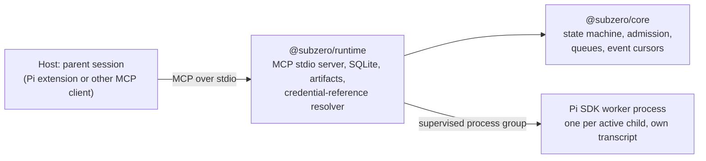

# Subzero design and behavior contract

Subzero is a host-neutral, local MCP service for delegating work to persistent child sessions. Protocol 0.2 and package version 0.2.0 are current; the separate template schema remains 0.1. Hosts keep their own parent conversation. Subzero is not an ACP facade, a provider catalog or a sandbox. Current verification is in [TESTING.md](TESTING.md); [earlier implementation evidence](reports/2026-10-09-token-efficient-subagents-implementation.md) is historical.

## 1. Ownership

- Host: parent conversation, transcript, model and UI.
- `@subzero/core`: child and run identity, state transitions, admission limits, follow-up queues, event cursors and request validation. It imports no Node, Pi, MCP SDK or SQLite package.
- `@subzero/runtime`: MCP stdio server, Node 24.15+ `node:sqlite` store, artifacts, credential resolution and the Pi worker adapter.
- Worker: the model loop, the durable child transcript and checkpoint, and child tool execution. Worker and SDK types stay private to the runtime adapter.
- `@subzero/pi`: registers the runtime through Pi's `registerMcpServer` and adds one bounded static `subzero_delegation` guide section before agent start. It imports neither SQLite nor the worker SDK and adds no native tool registry.

One broker process runs per active host MCP client; there is no daemon or listening port. Core requests worker closure before committing that run's terminal outcome. Confirmed exit permits settlement or a queued successor opening from the completed checkpoint; idle settled children remain ready. Unconfirmed exit retains ownership for recovery. Workers do not detach. Control-pipe EOF cancels the run and tears down ordinary descendants in the worker process group.

## 2. Operations and runs

The nine MCP tools are `subzero_info`, `subzero_spawn`, `subzero_run`, `subzero_get`, `subzero_list`, `subzero_send`, `subzero_stop`, `subzero_resume` and `subzero_output`. There is no delete tool.

Run states are `queued`, `running`, `stop_requested`, `stopped`, `completed`, `failed` and `interrupted`; interrupted means execution ended without a confirmed terminal result. A child is `ready`, `running` or `interrupted`.

- `spawn` creates a new child and its initial run and returns their IDs. `list` returns the workspace's children. `output` reads a stored result in bounded UTF-8 chunks. Core also exposes native `subscribe` for adapters that can consume an async iterator. The normative wire shapes are in [wire-operations.schema.json](../packages/core/schemas/wire-operations.schema.json) and [wire-responses.schema.json](../packages/core/schemas/wire-responses.schema.json); TypeScript types are in [types.ts](../packages/core/src/types.ts).
- `run` dispatches one run and waits up to `waitMs`, default 30 seconds. Run-specific `get` with `runId` defaults to zero wait. Both return a bounded snapshot of exactly the requested run: `childId`, `runId`, `status`, `waitExpired`, and a result or error code when available.
- A wait expiry or request abort only ends observation. It never stops accepted work; explicit `subzero_stop` does.
- Child-only `get` (no `runId`) returns child state and a bounded event batch. Its result is the child's latest result and can belong to an earlier run, so it is not the outcome of any particular run.
- `stop` requires `expectedRunId`; a mismatch returns `stale_run` without effect. A match clears queued follow-ups and sets `stop_requested`; `stopped` is set only after cancellation and process-group exit are confirmed.
- `send` takes `steer` (active run only; rejected as unsupported if the worker lacks steering) or `followup` (queues while busy, starts when idle).
- `resume` without a message validates credentials and the exact checkpoint and returns a ready child. With a message it starts a fresh run from the last completed leaf. Interrupted prompts and effects are never replayed automatically.

The MCP work budget `mcpRequestBudgetMs` defaults to 30000, must be a positive integer up to 2147483647, and should sit below the host request timeout. It bounds request work, not worker execution.

## 3. Models and credentials

Callers supply the model URL, model name, optional API protocol and a `credentialRef` explicitly on spawn and on explicit resume. The API protocol defaults to `openai-completions`; there is no URL-based inference and no advertised provider catalog. The runtime resolves a configured reference to key material in memory only for listed origins, and the core receives the literal key in process memory. Configured keys are redacted before persistence, and runtime credential resolution rejects a known key placed in a model URL. Native callers must supply secret-free metadata. Redaction covers configured secrets, not every secret reachable by the OS user. A missing reference returns `credentials_required`. After a broker restart the host must call `resume` with a credential reference before sending more work.

`subzero_info` returns `protocolVersion`, `coreVersion`, the worker name, version and capabilities, the available templates, `configuredModelRefs` and limits. It is not a host-compatibility or provider-API catalog.

## 4. Templates and grants

Built-in templates are `researcher` (read tools only) and `coder` (exact read, write and command tools); user templates are keyed by string ID. At spawn the resolved instructions, skill text and exact tool and MCP grants are persisted as an immutable snapshot, and resume reuses it. Nothing is inherited from the host or discovered ambiently. Built-in children have no Subzero delegation tools and nested delegation is outside the contract; no guarantee is made about arbitrary servers a user configures. Template MCP servers are launched only as declared and only their granted tools are exposed. If the worker cannot enforce the exact grant set, spawn fails before model execution. Grants fail closed.

## 5. Workspace, admission and ownership

The workspace root is the canonical scope and working directory, not a filesystem boundary. In the trusted core API it is a caller-supplied field:

    workspaceRoot: string; // host supplied execution context

MCP callers do not pass it; the server supplies its configured workspace. Pi's native file tools can reach paths outside it and a granted shell runs with the launching user's authority. Children share the workspace and the design is not an OS sandbox.

Admission is serialized through the shared SQLite database: at most one write-capable run per workspace across brokers; read-only children may run concurrently. This does not constrain the host or other processes writing files.

Ownership is an exclusive per-child generation. A new broker may claim a child only after the previous owner's release or confirmed worker exit. If exit cannot be proven, the result is `busy` or `recovery_required`; a second transcript writer is never started, and PID/TTL-only leases are not accepted as proof of worker exit.

## 6. Checkpoints and versions

The worker owns the transcript; SQLite records the last completed leaf. After a partial tool call, resume branches from that leaf and preserves the interrupted branch; the continuation prompt says it continues from a saved checkpoint and asks the worker to inspect the current workspace before acting. The required worker adapter and version and the session SDK and header version are validated, and immutable template grants are never upgraded. A mismatch or unreadable checkpoint is refused and stored state is preserved, never coerced, replayed, migrated or deleted. Sessions from prior SDKs need a new child.

## 7. Events, results and limits

Event rows carry per-child monotonic sequence numbers and record lifecycle, tool names, stop requests and confirmation, completion and errors. They omit raw tool arguments, secrets and transcripts; new worker text is not stored as per-token rows. When a requested cursor is older than retained history the response reports a cursor gap. Progress notifications are sent only for an active request that supplied a progress token and channel, are throttled and carry no transcript text. No unsolicited parent turn or background wakeup is promised.

Full results are stored as local artifacts; MCP returns a bounded preview and an opaque artifact ID that `subzero_output` reads by `offset` and `length`. Transcripts and artifacts are not deleted automatically.

Limits: four active worker processes per workspace, one write-capable run per workspace, 64 KiB prompt and instructions, 64 granted tools and 8 KiB per event payload. These are policy limits, not transport maxima, and there is no automatic retry.

## 8. Latest-only Pi and host scope

The host extension, runtime worker and `pi-ai` are exact-pinned to the latest Pi release, currently 1.2.0. Upgrades resolve npm's latest tag and re-pin exactly; no older lane, shim or fallback SDK is kept. The `subzero_delegation` guide and Pi `codemode` handling are qualified for Linux controlled print/JSON runs with loopback providers: with codemode, each MCP call resolves to a result object even on handled errors, so `isError` must be checked. `codemode.mode` stays the user's choice. TUI, RPC, reload, custom-triggered runtime turns, other hosts (Codex, Claude Code, OpenCode) and other platforms are not qualified. The separate experimental `pi-durable` package is not used and no second scheduler is added.
