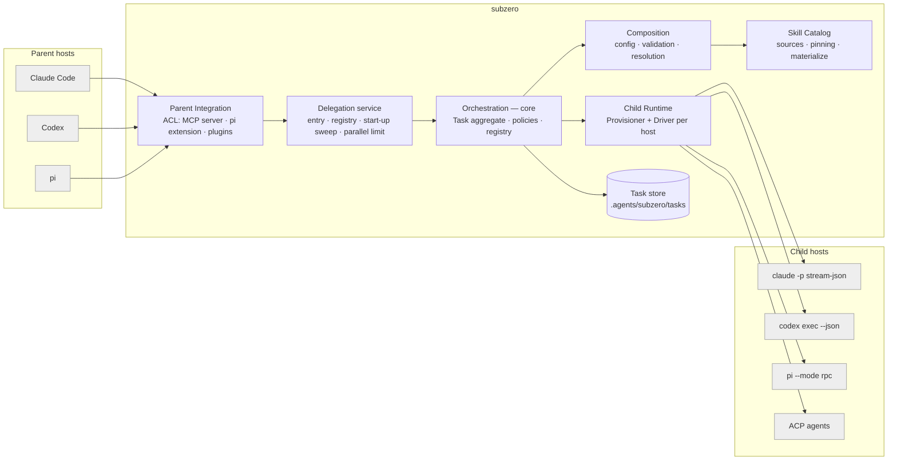
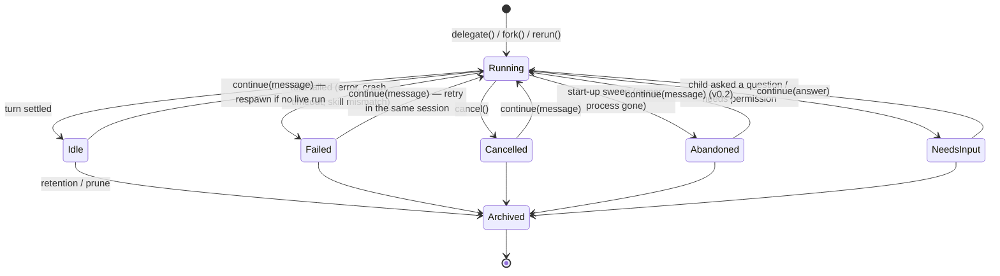
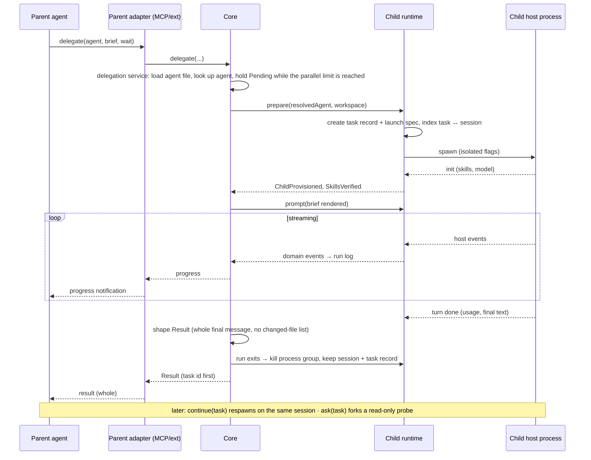

# subzero: domain design

Status: draft · 2026-10-30 · builds on [problem.md](problem.md); integration facts are in
[feasibility.md](feasibility.md); open items are in [decisions.md](decisions.md).

> **Update 2026-11-03.** The spike's Sigil contracts (`design/*.sigil`) refine this design, and where they
> differ they win. Folded in below: a **Delegation service** in front of the core; no changed-file list in
> the result (git is the record and the README warns the user); an `abandoned` task status and an owner
> process in the index instead of `parent_gone`; an optional **parallel limit** per model endpoint in
> `endpoints:` instead of a lock-file slot; one required `timeout` in seconds counted from spawn; load and
> unknown-agent errors; the project root resolved once; and an owner-only store folder that ignores itself.
> Decisions made while writing them are listed at the end of [decisions.md](decisions.md).

> **Update 2026-11-12.** pi becomes a second *parent host* (§5.5), and the Claude Code parent behaves the same
> way where Claude Code allows. The naming is fixed: a **parent host** is where you work (Claude Code, pi), a
> **child host** is what subzero starts (pi today); the bare word "host" is retired, and the agent-file key
> `host:` names the child host. The agent file changes: the model tier named `medium` is the default tier
> (there is no special `default` tier), and the file must hold `medium`, `general` and `fallback` or it does not load.
> There is no session-model fallback: a pi project with no agent file is refused with an error that says to run
> `subzero init`. The contracts `design/*.sigil` win where they differ; the new ones are
> `design/pi-extension.sigil` and `design/claude-plugin-commands.sigil`, and the former `mcp-server` and
> `routing-hooks` contracts are now `design/claude-mcp-server.sigil` and `design/claude-routing-hooks.sigil`.

## 1. Ubiquitous language

| Term | Meaning |
|---|---|
| **Parent host** | The coding agent the user works in and delegates from (Claude Code, Codex, pi). |
| **Parent model** | The model that works inside a parent host: it writes requests and reads notices and results. |
| **Child** | A coding-agent process that subzero starts to do one delegation. |
| **Child host** | The kind of agent runtime that subzero starts as a child: `claude`, `codex`, `pi`, `acp:<name>`. The agent-file key `host:` names it. The same program can be a parent host in one process and a child host in another, and the two names never mean each other. |
| **Agent definition** | An agent entry of `agents:` resolved at one model tier: the tier a call names, else the entry's own `tier:`, else the `medium` tier, with the entry's `tiers:` override applied field by field. It has the entry's description, skills, tools and timeout and the child host, model and thinking level of that tier, and is named `<entry>` or `<entry>:<tier>`. Like a compose *service*. |
| **Skill** | An Agent Skills folder (`SKILL.md` plus resources). Referred to by name; resolved from a **skill source**. |
| **General agent** | The `general` entry of `agents:`, with no description and, like every agent, no host, model or thinking of its own. It takes a delegation that names no agent (or names `general`) with its full tools, on the `medium` tier, or on the tier a call names (`general:<tier>`). |
| **Fallback agent** | The `fallback` entry of `agents:`, with no description. It runs a delegation whose agent name is not configured, and the reply says so. `subzero init` writes its tool list read-only. It is required: a file without it does not load. |
| **Model tier** | A name under `models.tiers` (`medium`, which is required and is the default tier, and others such as `small`, `large`) that gives a child host, a model and a thinking level. An agent runs on the tier a call names, else its own `tier:`, else `medium`, and its `tiers:` block overrides fields of a tier for it alone. A tier is *routable* when its host, after the general agent's override, has a registered child driver; the Claude Code hook routes only tiers that a CE tier word maps to (`small`, `medium`, `large`). |
| **Kernel** | The small core component where child drivers (by child host) and parent adapters (by name) register. Core services reach drivers only through it and never name one. |
| **Child driver / Parent adapter** | The extension for one child host, or for one kind of parent. Each is registered with the Kernel by its process's **entry point**, which is the only code that names it. A child driver also offers its **starter tools**, the full and the read-only tool list that `subzero init` writes. |
| **Pass-back** | A Claude Code Agent spawn whose short description begins with `passback`. Claude uses it to hand a subagent back to its own Agent tool when `delegate` is refused or errors with no task. |
| **Resolved agent** | An agent definition with every reference resolved: skill folders pinned (content hash), model mapped to the child host, defaults applied. Immutable. Like a compose *image*. |
| **Delegation** | One request from a parent: *agent + brief*. It creates one **task**. |
| **Brief** | The self-contained task text plus optional context (file paths, constraints, expected output) that the parent sends. The child sees nothing else from the parent. |
| **Task** | The unit the parent holds. It has a stable **task id** (`sz-7f3k2q`) and is tied to exactly **one child session** for its whole life. It is continued, asked about, forked and rerun by that id. Like a compose *container*, which survives restarts. |
| **Child session** | The host's own conversation for a task (the pi session file). It holds the full transcript and never crosses into the parent. |
| **Run** | One child **process** working on a task. A task can have many runs: the process exits after a turn, and a later `continue` **respawns** it on the same session. |
| **Turn** | One input to the task (the brief, a follow-up, or an answer), processed until the child settles. Every turn returns exactly one **result**. |
| **Report** | A digest of everything a task did, built from its events without an LLM: turns, files read and changed, commands, skills used, errors, usage. |
| **Probe** | A read-only fork of a task's session, used to answer a question about the work (`ask`) without touching the main session. |
| **Workspace** | The filesystem view the child gets: working directory, extra dirs, and the **skill overlay** (a directory holding *only* the declared skills). The host's own home stays the user's real one: same login, same session storage. |
| **Task record** | `.agents/subzero/tasks/<task-id>/`: the frozen agent, the **launch spec** (exact argv, cwd, host version), the id mapping to the child session and the parent session, runs, turns, results, report and event log. Enough to continue, respawn, fork, rerun, ask, inspect or attach later. |
| **Launch spec** | A neutral record, defined by the core, of how a driver started a child: the command as an opaque list without the prompt, the working directory, environment variable **names** (never values), the host version, the skill folder paths and the thinking level. Each driver fills it in. |
| **Result** | What goes back to the parent: status, the child's whole final message as the summary (never cut), optional structured output, usage and cost. It carries no changed-file list: the user reviews the tree with git. |
| **Owner process** | The process that created a task and runs its child, recorded by pid and start time on the task's first index line. |
| **Start-up sweep** | Marks a task `abandoned` when its latest index line says running and its owner process is gone or has another start time. It signals no process. |
| **Parallel limit** | An optional cap, per model endpoint, on how many children one process runs at once. Waiting delegations stay `Pending`. |
| **Session cancel** | Cancels every Pending and live task of one parent session in this process and reports how many. A completed task is not touched. |
| **Completion notice** | The text that tells the parent model that a background task settled: which task, its status, how to collect the result through the front end's collect tool, the tasks of that session still running, and to wait for them. It carries no result text. A **stop notice** says that a task was stopped and that no action is needed; a session cancel gives one for each task it stopped. |
| **Delegation service** | The one entry every front end goes through. It resolves the project root, runs the start-up sweep, looks up the agent, holds the live task registry and connects the core to the child port and the task store. |
| **Event log** | The full normalized event stream of a task across all its runs, stored on disk. It is never sent to the parent. |

## 2. Bounded contexts



| Context | Responsibility | Owns | Relationship |
|---|---|---|---|
| **Composition** | Parse, merge and validate `.agents/subzero.yaml` and skill manifests; produce `ResolvedAgent` | AgentDefinition, Defaults, Profiles | Upstream of Orchestration (published language: `ResolvedAgent`) |
| **Skill Catalog** | Resolve skill refs (local path, git, npm), pin content hashes, check portability, materialize into a host-specific layout | Skill, SkillSource, SkillLock | Upstream of Composition and Child Runtime |
| **Delegation service** | The entry that makes the core ready to delegate: resolves the project root once, runs the start-up sweep, loads the agent file on each delegation, holds the live task registry and applies the parallel limit | DelegationService, live task registry | In front of Orchestration; every front end (MCP server, CLI) goes through it |
| **Orchestration (core)** | Task lifecycle, runs and turns, state machine, policies (timeouts, budgets, depth), result shaping, reports, probes | **Task** (aggregate root), Run, Turn, Result, Report, Policy | Core domain |
| **Parent Integration** | Turn host tool calls and skills into domain commands and back. One adapter per parent host. | Tool schemas, proxy skills, progress mapping | Anti-corruption layer (ACL) in front of the core |
| **Child Runtime** | Provision an isolated child for a host and drive it. Normalize host events into domain events. | Provisioner, Driver, HostCapabilities | ACL behind the core; one adapter per child host |
| **Task store** | Persist task records, the id index, event logs, results and reports | TaskRecord, TaskIndex | Supporting |

The core never imports host-specific types. Both adapter layers depend on the core's ports
(hexagonal architecture). A small **Kernel** (`design/kernel.sigil`) is the one place where the two adapter
layers plug in. Each child driver registers with it for one host, and each parent adapter registers by name. The
core (Kernel, config, task core, task store, Delegation service, CLI) asks the Kernel's registry for the child
port, attach command, session export and starter tools of a host, and never names or imports a particular
driver or parent adapter, so a Claude or Codex child, or a pi or Codex parent, is added without touching the
core. Each process has an **entry point** that is outside the core, imports the drivers and adapters it needs
and registers them before its first request. A child driver receives the project root, the sessions folder and
its driver-files folder through the child port on each start and resolves none of them itself:

```
ParentPort (driving):  delegate · continue · ask · tasks · await · cancel
ChildPort  (driven):   Provisioner.prepare(ResolvedAgent, WorkspaceRequest) -> PreparedChild
                       Driver.start(PreparedChild) -> ChildHandle
                       Driver.start(PreparedChild, { resume?: SessionRef, fork?: {SessionRef, at?} })
                       ChildHandle.prompt(text) · .cancel() · .events(): AsyncIterable<ChildEvent> · .dispose()
                       Driver.capabilities(): HostCapabilities
```

### Key design insight: separate provisioning from transport

Every child host needs two separate things:

1. **Provisioning** (always host-specific): how to make *only* these skills visible, set model and
   reasoning, apply sandbox and permissions, and keep user and repo config out. Examples are
   `pi --no-skills --skill …`, the real `CODEX_HOME` with `--ignore-user-config` and `-c` skill
   disabling, and `claude --disable-slash-commands` plus the declared skills inlined (§6.1, D18).
2. **Transport** (can be shared): how to send a prompt and receive events. Options are native JSONL
   (`claude -p --output-format stream-json`, `codex exec --json`, `pi --mode rpc`) or **ACP**.

ACP standardizes transport (sessions, prompts, updates, permission requests, cancel). It has **no
skills concept**, and its client-provided system prompt (RFD #1237) is still unstable. So "ACP or CLI"
is not an either/or choice. A child adapter is `Provisioner × Transport`. Provisioners are written per
host, and the ACP transport is a reusable driver that can be paired with any provisioner whose host has
an ACP adapter.

## 3. Core domain model

### 3.1 Aggregate: `Task` (with Runs and Turns)

```
Task                      the aggregate root: the id the parent holds
  id: TaskId              "sz-7f3k2q": short, stable, easy to type. Also used as the child session id
                          where the host accepts one (pi). Otherwise (claude needs a UUID, codex
                          assigns its own) the host's id is stored in `child.sessionId` and the index.
  agent: ResolvedAgent    frozen at creation (+ agentHash); continuing never changes the skills
  origin: Origin          { parentHost, parentSessionId, toolUseId, depth }: who asked
  lineage: Lineage?       { forkedFrom?: {task, turn}, rerunOf?: task, probeOf?: task }
  child: ChildSessionRef  { host, sessionId, sessionFile, launch: LaunchSpec }
  runs:  Run[]            one per child process
  turns: Turn[]           one per input
  report: Report          rebuilt after every turn
  owner: OwnerProcess     { pid, startTime }: the process that created the task and runs its child
  status: TaskStatus      running | idle | needs_input | failed | cancelled | abandoned | archived
                          running covers Pending, Starting and Live; abandoned is set only by the start-up sweep

Run   { runId, pid, overrides{model?,thinking?}, startedAt, endedAt?,
        exit?: settled | crashed | killed | timed_out }
Turn  { turnId (1,2,3…), kind: brief | followup | answer, input, by: parent | user,
        runId, entries: {firstId, leafId}, result: Result, usage }
LaunchSpec { command (opaque list, without the prompt), cwd, envNames (names only), hostVersion, skillPaths, thinkingLevel? }
                          neutral: defined by the core, filled in by each driver
```

`entries` are the child session's own entry ids (pi entries have stable ids). They let subzero fork
"at turn 2" and read exactly the events of one turn.

Invariants:
- **One task ↔ one child session, for life.** Anything that needs a *new* session is a *new task* with
  `lineage` (fork, rerun, probe). This 1:1 mapping keeps "continue task X" unambiguous.
- **A task whose owner process is gone is `abandoned`.** It has no result. It can still be listed,
  attached and shown, and a result already stored in its record outranks a later `abandoned` line.
- **At most one live run per task**, enforced by a task lock. A `continue` that arrives while a turn is
  running is queued as the host's follow-up (pi `follow_up`), or rejected with `busy` if the parent asked
  for that.
- **Respawning is transparent.** If a task is idle and its process has exited, `continue` starts a new
  run with the *same* LaunchSpec plus the session file. The parent never sees the difference; only the
  task record gains a run.
- **The agent is frozen.** `continue` may override only model, thinking and deadlines, which are
  recorded on the Run. Different skills means a new task (`rerun` with another agent). If the YAML has
  changed since the task was created, `continue` keeps the frozen version and says so in the result.
- **Every turn returns exactly one `Result`.** Its summary is the child's whole final message, never
  cut; the reply budget in the brief guides its size. The transcript, tool output and skill content
  never cross into the parent.
- `depth ≤ policy.maxDepth`, which stops a child from recursively delegating through its own subzero.
- **When a run ends, the context ends with it; the task stays.** The process group is killed, so the
  skill content in the child's context is gone. The task record and child session are kept until
  `retention` expires, so the task can be continued, asked about, forked, rerun, inspected or attached.

### 3.2 Lifecycles

Task:



Failed and Cancelled are **not** final. The session still exists, so the parent or the user can continue
it ("you hit a timeout; carry on from where you stopped").

Run (one process):
`Pending` (held back while its model endpoint's parallel limit is reached) → `Starting` (spawn, verify skills) → `Live` → `Exited(reason)`.
With `process: exit` (the default), the run exits once its turn settles. With `process: keep`, it stays
`Live` until the TTL runs out, so quick follow-ups skip the cold start. Either way the task becomes `Idle`.

### 3.3 Domain events

These are written to the run log and used for parent progress notifications:
`TaskCreated(lineage)`, `RunStarted(launch, overrides)`, `ChildProvisioned(model, reasoning applied)`,
`SkillsVerified`, `TurnStarted(kind)`,
`AgentMessage(delta|final)`, `ToolActivity(name, args summary, status)`, `FileRead(path)`,
`FileChanged(path)`, `SkillUsed(name)`, `InputRequested(question|permission)`, `TurnSettled(result)`,
`RunExited(reason)`, `TaskStatusChanged`, `TaskArchived`.
The **report** (§3.5) is a projection of these events.

Each driver maps its host's stream onto these events:

| Domain event | claude stream-json | codex exec --json | pi rpc/json | ACP |
|---|---|---|---|---|
| ChildProvisioned / SkillsVerified | `system/init` (lists `skills`, `plugins`, `mcp_servers`) | `thread.started` (no skill list, so check separately) | `session` header + `get_commands` | `initialize` + `session/new` |
| AgentMessage | `assistant` / partial messages | `item.*` agent_message | `message_update` text_delta | `session/update` agent_message_chunk |
| ToolActivity | `tool_use` / `tool_result` | `item.*` command_execution, mcp_tool_call | `tool_execution_*` | `tool_call` / `tool_call_update` |
| TurnSettled | `result` (`total_cost_usd`, `session_id`) | `turn.completed` (`usage`) | `agent_settled` (not `agent_end`) | `session/prompt` response `stopReason` |
| InputRequested | permission-prompt tool / denied | n/a in exec (policy only) | `extension_ui_request` | `session/request_permission` |

### 3.4 Value objects

- **ModelRef**: `provider/model` (e.g. `ollama/qwen3-coder`, `anthropic/claude-sonnet-5-5`). It is
  checked against the host's compatibility matrix when the definition is resolved, not at run time.
- **Reasoning**: `off | minimal | low | medium | high | xhigh | max`. Each host gets a mapping that may
  lose detail, and the core reports what it actually applied in `ChildProvisioned`. Examples: Claude has
  no `off` on 5.5 models, so `off` is clamped to `low`. Codex values depend on the model.
- **SkillRef**: `name` plus the source it resolves to, pinned in `subzero.lock` (path, git rev, sha256).
- **Brief**: `{ task, context?, files?[], expectedOutput?, outputSchema? }`.
- **Result** (one per turn): `{ task, turn, status, summary, structured?,
  questions?[], usage{tokens,usd,duration}, next: [continue, ask, fork] }`. There is no changed-file list.
  `status` is `completed | truncated | needs_input | failed | cancelled`. `truncated` means only that
  the child stopped at its own length limit. `cancelled` is a status and carries no failure kind. A
  usage field the driver cannot report is marked unavailable and is never zero. `needs_input` carries
  `input.kind: question | permission`, matching `InputRequested`. `failed` carries a `reason`:
  `skill_mismatch | timeout | crashed | error`. The task id always comes
  first, so it survives in the parent's history and after compaction. The summary is the child's whole
  last assistant message and is never cut, so a long answer or a JSON reply reaches the parent intact.
  Its size is guided, not enforced: a front end that knows its parent's inline limit tells the child a
  **reply budget** in the brief (the MCP server says 48,000 characters, under Claude Code's 50,000
  inline limit; a longer reply is saved to a file by Claude Code, not truncated). An empty summary
  stays empty.

### 3.5 Knowing what the child did, without its context

The parent gets only what it asks for. The child's full context stays in the child session, and a
result is the child's final answer only, whole.

| Level | What the parent gets | Size | How it's produced |
|---|---|---|---|
| **Result** | Final answer, whole, status, task id | Whole; guided by the reply budget in the brief | Automatically, every turn |
| **Report** | Turns with their inputs, files read and written (from the child's own tool activity, not from git), commands with exit codes, skills used, errors, usage | ≤ ~1k, or one turn | `tasks(task, detail: report)`. A projection of the event log, **no LLM call** |
| **Ask** | An answer to any question about the work ("why did you choose X?", "which tests did you run?", "show the function you changed") | Whole; guided by the reply budget in the brief | `ask(task, question)`: a **probe** (below) |
| **Transcript** | Everything | never sent to the parent | For humans: `subzero show`, `subzero attach` |

**How `ask` works.** The child already holds the full context of its work, so it is the best analyst of
it. subzero forks the task's session into a **probe task** (`lineage.probeOf`) with a read-only tool set,
sends the question, and returns the answer whole. The probe gets its own task id, so its Q&A is kept
for audit.
- The main session is untouched: later `continue` turns don't see the Q&A.
- The parent only pays for the answer.
- It costs one turn on the child's model. On a local model, the prompt cache may make this cheap.
- For pi: `--fork <session file> --session-id sz-<task>-q<n> --tools read,grep,find,ls`.

### 3.6 Identity mapping and storage

```
.agents/subzero/
  .gitignore                  # created with the folder; ignores everything in it (`*`). An existing one is left
                              # alone and the user's own .gitignore is never edited. The folder is owner-only (0700).
  index.jsonl                 # one line per status update (append-only, latest line wins):
                              #   task, agent, status, parentHost, parentSessionId (optional), toolUseId,
                              #   childHost, childSessionId, sessionFile, lineage, createdAt, updatedAt;
                              #   the first line of a task also records its owner process (pid, start time)
  tasks/<task-id>/
    task.json                 # aggregate snapshot: agent (frozen), launch spec, runs, turns, status
    events.jsonl              # domain events across all runs
    turns/<n>.json            # input + the exact Result the parent received. Written in one step, and before
                              # the index line that gives its status, so a stored result outranks the index
    report.md                 # current report (§3.5)
  sessions/                   # pi child session files, named after the task id
```

Lookups the index supports:
- **task → child session**: used by continue, respawn, fork, ask, attach.
- **child session → task**: used when the user finds a `subzero:*` session in pi's `/resume`.
- **parent session → tasks**: "what did my subagents do in this conversation?" Works after compaction
  and `/clear`, because the parent adapter records the parent session id; on Claude, through the
  SessionStart hook.
- **task → lineage**: forks, reruns and probes of a task.

The start-up sweep reads the index at every start-up of a front end and again before a collect, a cancel
and a listing. A listing from the `tasks` tool holds at most 50 tasks, running ones first.

**Why child sessions live in `.agents/subzero/sessions/` and not in pi's own folder.** The task record
already maps a task to its session file (read back from pi's `get_state.sessionFile`), so a mapping alone
would find the session anywhere. The separate folder (`--session-dir`, required by `design/pi-driver.sigil`)
is chosen for five reasons:
1. **Isolation (P21).** A child ran with only its declared skills and no extensions or context files. In
   pi's own folder it would show in `/resume`, and resuming it there loads the user's full setup into it.
2. **Clutter (P22).** A review can start 5–10 children; they would mix with the user's own sessions.
3. **Cleanup.** `prune` (v0.2) deletes a task's record and its session together, inside subzero's own store,
   never inside `~/.pi/agent/sessions`.
4. **Secrets.** Sessions hold tool output. The store folder is owner-only (0700) and ignores itself in git;
   subzero does not control pi's folder.
5. **Session id clashes.** The pi session id is the task id. An id that matches a session of another project
   makes pi ask on stdin, which would break the RPC stream (target-claude-pi.md §3.4; seen on an earlier pi).

The sessions are not hidden. `pi --session-dir .agents/subzero/sessions --resume` (or `--session <task id>`,
or `PI_CODING_AGENT_SESSION_DIR`) opens them, and `pi --export <file> out.html` writes a read-only page.
Opened that way, a session runs under the user's own skills, extensions and AGENTS.md, and pi does not lock
session files, so typing while the task runs would interleave writes. `subzero show` and `subzero attach`
reuse the child's launch spec, and `attach` is refused while a run is live. The README tells users the same.


## 4. Configuration (`.agents/subzero.yaml`)

This section is the design. What the code reads today, key by key, with the errors it gives and what is not
supported yet, is in [configuration.md](configuration.md). The example below includes keys that are not built
(`version`, `defaults`, endpoint connection fields, agent fields beyond `tools`, `timeout`, `tier`, `tiers`,
`skills` and `description`); the loader ignores unknown top-level keys and rejects unknown agent keys.

It is modelled on compose: a top-level map of named agents, shared defaults, a skill source map,
override files, and `${ENV}` interpolation. The `agents:` map may hold two entries without a description, `general` and
`fallback`; beside it the file holds the `models.tiers` map and the `routing` settings (§4.2).

```yaml
version: 1

defaults:                    # agent defaults; host, model and thinking come only from models.tiers
  workspace: shared          # shared | worktree  (where the child works)
  permissions: read-only     # read-only | workspace-write | full  (what it may do there; D8)
  timeout: 1800              # example value. Spike: required, in seconds, wall-clock from spawn to settlement,
                             # including skill verification; time spent Pending does not count.
                             # An idle limit (`idle:`) is v0.2.
  process: exit              # exit (kill when the task ends) | keep (stay alive for follow-ups, ttl)
  record: keep               # keep (host session + run record kept) | none (nothing written)
  retention: 30d

skills:                      # paths are relative to this file; bare names fall back to ./subzero/skills/<name>
  skill-a: ./subzero/skills/skill-a
  skill-b: git+https://github.com/acme/skills#path=skill-b&ref=v1.4.0

endpoints:                   # named model endpoints, defined once and reused. An agent definition belongs to the
                             # endpoint named by the part of its model before the first slash (`local/qwen3-coder-30b`)
  local:
    base_url: http://localhost:8000/v1   # v0.2; in the spike pi's own models.json holds the server
    api: openai-completions              # v0.2: what the child host must speak
    api_key: ${LOCAL_API_KEY}            # v0.2
    parallel: 1              # cap on children this process runs at once on this endpoint, shared by every agent
                             # definition on it. Spike: an entry must hold a positive whole number, and an endpoint with no
                             # entry has no cap. v0.2: optional once an entry has other fields. An entry that no
                             # tier or override model belongs to is a load error

models:
  tiers:                     # the only place that says what runs a child: host, model and thinking
    medium: { host: pi, model: local/qwen3-coder-30b, thinking: medium }   # required: the default tier (`host:` names the child host)
    small:   { host: pi, model: local/qwen3-4b,         thinking: off }
    large:   { host: claude, model: anthropic/claude-opus-5-5, thinking: high }   # child host: claude | codex | pi | acp:<agent-id> | native | inline

routing:                     # Claude Code routing by model tier (§5.2), read by the hook processes alone; both keys optional
  hook: true                 # false: keep the session-start text but let every Agent spawn through
  generic_agents: [general-purpose, claude]   # agent types the hook treats as generic; replaces the default list

agents:
  general:                   # work that names no agent, and tiered work. No description: never chosen or offered by description
                             # runs on `medium`, or on the tier a call names (general:small, general:medium, general:large)
    tools: [read, bash, edit, write, grep, find, ls]   # full tools, so compound-engineering reviewers keep full fidelity
    timeout: 1200
    skills: []
  fallback:                  # work of an agent name that is not configured. Optional; `subzero init` writes it read-only
    tools: [read, grep, find, ls]      # read-only: a mistyped name cannot write or run shell commands
    timeout: 1200
    skills: []               # no description either. With no `fallback`, an unknown name is an error
  semanticizer:
    description: >           # REQUIRED - this is all the parent sees when routing
      Builds a semantic model of a module. Use for "what does X mean / how is Y modelled".
    skills: [skill-a, skill-b]
    tier: medium             # its own tier when a call names none (else `medium`)
    timeout: 1200            # required on every agent
    tiers:                   # per-agent override of a tier's host, model or thinking, like a compose override
      medium: { thinking: high }
    instructions: |          # appended to the child's system prompt
      Answer with a concise summary first, then details.
    tools: [read, grep, find, bash]   # host-neutral allow-list, mapped per host
    permissions: read-only   # read-only | workspace-write | full  (maps to host sandbox flags)
    delegates: []            # agents this child may delegate to (nested; D14, v0.2). Empty = no delegate tool
    result: { report_file: false }  # true: full output goes to a file; the result carries summary + path
    output:
      schema: ./schemas/semantic-model.json   # optional structured result
    expose:
      tool: true             # visible through the delegate tool
      proxy_skill: true      # also install a tiny proxy SKILL.md in the parent (see §5.2)
```

### 4.1 Where definitions come from: the workspace or the skill

An agent definition can come from two kinds of places, which are merged in layers.

1. **Workspace compose file.** It lives in `.agents/`, next to the `.agents/skills/` folder that
   agents already share:

   ```
   .agents/
     subzero.yaml          # team config, committed
     subzero.local.yaml    # personal overrides, gitignored
     subzero.lock          # pinned skills + host versions, committed
     skills/               # host-visible skills; subzero writes only proxy skills here for Codex/pi parents (§5.2)
     subzero/
       skills/             # subzero-managed skills, committed. NOT under .agents/skills (P19)
       index.jsonl         # task index (§3.6), gitignored
       tasks/              # task records, event logs, skill overlays (§3.6), gitignored
       sessions/           # pi child sessions, gitignored
   ```

   The user-level file is `~/.agents/subzero.yaml`, mirroring `~/.agents/skills`. **Built** (see
   [configuration.md](configuration.md#the-general-file-one-setup-for-every-project)): the file holds
   only `models.tiers`, endpoint `parallel` limits and `routing`, and the workspace file is merged over
   it by name, a workspace entry replacing the user entry whole, with `enabled: false` in the
   workspace file as the opt-out. Agents and skills stay out of it. **Not built**: endpoint keys and
   addresses, `subzero.local.yaml`, `subzero.lock` and skill manifests.
2. **Skill manifest.** A skill can ship its own recommended agent definition in
   `<skill>/agents/subzero.yaml`. Codex already uses `agents/openai.yaml` inside a skill folder the same
   way. This is how a skill author says "this skill should run as a sub-agent, set up like this".
   It is not put in the `SKILL.md` frontmatter, because Agent Skills `metadata` is a flat string map
   and other hosts would see the unknown keys.

```yaml
# .agents/subzero/skills/semantic-model/agents/subzero.yaml
agent:
  name: semanticizer            # default: the skill's name
  description: ...              # default: the skill's SKILL.md description
  skills: [self, helper-skill]  # `self` = this skill; others must already be in the catalog
  tier: medium                  # a hint, not an endpoint; the workspace's tiers say what runs it
  permissions: read-only
```

**Precedence, lowest first:** skill manifest, then user config, then `.agents/subzero.yaml`, then
`.agents/subzero.local.yaml`. Built today: user config under `.agents/subzero.yaml`, merged by name as
above. Not built: the skill manifest and `.agents/subzero.local.yaml` layers, and field-by-field
agent merging. Agents are merged by name, field by field, as compose does. The workspace can
override or turn off a skill-provided agent:

```yaml
agents:
  semanticizer: { tier: large, tiers: { large: { thinking: high } } }   # override fields
  noisy-agent:  { enabled: false }                     # turn off a skill-provided agent
```

**Limits on skill manifests** (a skill is third-party content, a workspace is not):
- **Models are tiers or aliases, never endpoints.** A skill author doesn't know your servers or keys.
  The `models.tiers` map in user or workspace config turns `tier: medium` into a real host, model and
  thinking.
- **Permissions can be requested but not granted.** A manifest that asks for `workspace-write` is held
  at `read-only` until the workspace or user config grants it.
- **No new skill sources.** A manifest can only name itself and skills already in the catalog. It cannot
  pull in git URLs.
- If two skills define the same agent name, it is an error until the workspace picks one.

**Discovery.** subzero reads the workspace and user files, then scans every skill in the catalog for
`agents/subzero.yaml`. `subzero config` prints the merged result and the file each field came from,
like `docker compose config`.

**Keep the original skill away from the parent.** If a subzero-managed skill sits in a directory the
parent host also scans (`.agents/skills`, `.claude/skills`, the pi skills dir), the parent can load it
directly. That skips subzero and brings back the context pollution. So:
- subzero-managed skills live outside host discovery paths, in `.agents/subzero/skills/`. Codex and pi
  scan `.agents/skills/` but not this folder,
  and subzero writes only the proxy skills (§5.2) into the host directories;
- if a skill has to stay in a host directory, subzero turns it off in the parent: Claude
  `skillOverrides: "off"`, Codex `[[skills.config]] enabled=false`, and the pi equivalent (⚠ to verify).

### 4.2 Rules

- **Load and lookup.** The agent file is read again on each delegation. A missing, unreadable or malformed
  file, or any invalid agent or endpoint entry, is a **load error** that fails the whole load and makes no
  task. The file must hold the `medium` tier, a `general` agent and a `fallback` agent, or it does not load, and the load error names the missing one. An unknown agent name runs the `fallback` agent, which the load guarantees.
- **General and fallback agents.** Two entries of `agents:` named `general` and `fallback`, with no description and, like every agent, no host, model or thinking (a
  description on either fails the load), so a name lookup, a tier or an explicit request finds them like any agent
  and no agent name is reserved. They are never chosen by description and are left out of the routed catalog and the
  proxy skills. Both are required. `general` takes work that names no agent and tiered work (`general` on `medium`, `general:<tier>` on a named tier), and runs with its full tool list. `fallback` takes the work of an agent name that is not configured: its reply says the named agent is not
  configured, its task records the agent as `fallback`, and its tool list is read-only by what `subzero init`
  writes (the load cannot enforce it, because only the host knows which tool names only read). A call that names
  `fallback` itself runs it with no such notice.
- **Model tiers and routing.** `models.tiers` gives each tier a host, a model and a thinking level, and `medium` is required, and is the default tier. Agents never set host, model or thinking directly. An agent runs on the tier a
  call names, else on its own `tier:`, else on `medium`, and its `tiers.<name>` block overrides fields of that tier for
  it alone, as a compose override does; it is recorded as `<agent>:<tier>` when the call names a tier. A tier is
  routable when its host has a registered child driver; a tier whose host has none still loads and fails only when
  used, with a tier error that names the tier, the configured tiers and, when the host is the cause, the host and the supported hosts. Routable tiers are only a listing, for the tool description and the hook; the child host of the resolved definition decides whether any agent runs. `routing.hook` (on unless set to false) and `routing.generic_agents` are read from the same file by the Claude Code hook processes alone: they belong to the hooks, not to the agent configuration. An unmatched `tier` value is ignored on pi (the reply says the value was not used) and returned as a tier error with a pass-back on Claude Code. An endpoint entry must be used by the model of at least one tier or override, or the load fails.
- **`subzero run`.** The agent is the named option `--agent`, which may be left out: with none, the delegation names no agent and runs `general`, and a lone argument is always the brief.
- **Host check.** The host of an agent's resolved definition must have a registered child driver. A request that
  resolves to a tier whose host has none returns a tier error (not a load error) that names the tier, every configured
  tier, the host and every supported host; the tier still loads. The supported hosts come from the caller, which gets
  them from the Kernel; given none, nothing checks a host. The Delegation service and the MCP server's tool listing pass
  them; `subzero init` and the hook process (no Kernel) pass none.
- **`subzero init`.** Takes a model and the named options `--host` (it may be left out when exactly one is registered; with
  none registered `init` refuses), `--timeout` (default 1200 seconds, the length of CE's reviewer budget) and `--thinking`
  (default `medium`; the schema requires one). It
  adds a `medium` tier (child host, model, thinking) and a `general` and a read-only `fallback` entry under `agents:`, each only when the map lacks it, using the
  starter tools that the host's child driver offers (for pi, `read, bash, edit, write, grep, find, ls` and
  `read, grep, find, ls`) and no skills, under the project root that the Delegation service resolved. It changes
  no existing line and writes nothing when the file exists and does not load, except that it adds any missing starter entry (`medium`, `general` or `fallback`) to a file that already holds agents. It refuses, naming both child hosts, when the file has a `medium` tier on another child host; it also refuses when the host is missing and several are registered, when the host is not supported, and when the host's child driver offers no starter tools.
- **Endpoints.** An endpoint is defined once under `endpoints:` and reused by every agent definition whose model starts
  with its name, so they share its `parallel` limit. In the spike an entry holds only `parallel`; its
  `base_url`, `api` and `api_key` join it in v0.2, replacing the former `models:` endpoint entries.
- **Parallel limit.** The Delegation service counts only the children of its own process that are
  `Starting` or `Live`. Past the limit a delegation stays `Pending` and is released first come first served
  when one ends, whether it settles, fails or is cancelled. A second process or window is not counted, and
  nothing is locked or signalled across processes.
- **Project root.** Resolved once for each Delegation service (one per process on Claude Code, one per pi session on pi): `SUBZERO_PROJECT_DIR` (empty counts as unset), then the
  first root the parent reports, then the CLI's working directory; never the server's own. It is absolute
  with symbolic links resolved. When none resolves, every call returns an error that names
  `SUBZERO_PROJECT_DIR` until one does.

- `subzero validate` checks the schema, merges all sources, resolves skills, checks that each model is
  compatible with its host, lints skills for portability, and writes `subzero.lock`.
- **A repo's `.agents/subzero.yaml` is executable configuration.** It starts processes with permissions.
  Using it requires an explicit trust step, the same way pi and Codex trust project config.

## 5. Parent integration

### 5.1 Tool surface (host-neutral)

Six tools. None returns a transcript, and none cuts a result: an `await` reply that would pass the parent's inline limit gives the later results as one-line pointers to `tasks(<id>)` instead. On Claude they appear as
`mcp__plugin_subzero_subzero__<tool>`.

| Tool | Input | Returns | Session effect |
|---|---|---|---|
| `delegate` | `agent?`, `tier?`, `brief`, `files?`, `expected_output?`, `from?: {task, mode: fork \| rerun, at_turn?}`, `wait?` | `Result` with a **new task id** | New task + new session. Fork branches from `from.task`'s session (at a turn); rerun starts fresh with the same brief. |
| `continue` | `task`, `message`, `overrides?: {model, thinking}`, `wait?` | `Result` of the new turn | **Same task, same session.** Respawns the child if its process has exited. |
| `ask` | `task`, `question` | The answer, whole | Probe task (read-only fork); the main session is untouched |
| `tasks` | `task?`, `scope?: conversation \| all`, `detail?: list \| report \| turn:<n>` | Task list (id, agent, status, creation time; at most 50, running first, with a notice of how many were left out) or one task's report | None |
| `await` | `tasks[]`, `timeout_s` | `Result[]` for finished turns | None |
| `cancel` | `task?` | Final status, or the count cancelled when no task is given | Aborts the running turn; the task stays continuable. With no `task` it runs a session cancel for the current parent session. |

The agent catalog comes from the proxy skills (§5.2) and the server instructions, not from tool
descriptions. **The server instructions must tell the parent to write a self-contained brief.**

`wait` mode sends progress notifications on every domain event, which keeps Claude Code's MCP idle
timeout from firing. Progress is one line from the latest event (agent, kind of event, tool and target
path, elapsed time; "waiting" while `Pending`), at most once a second, with a heartbeat after 30 s of
silence, and never agent text, tool output or stderr. A `cancel` of a task that another process owns says
so and changes nothing. If the parent cannot hold a long call open (Codex `tool_timeout_sec` defaults to
60s), the adapter returns the task id early and the parent calls `await`.

### 5.2 Three triggers: explicit, proxy skill, and sub-agent routing

- **Explicit**: the parent picks an agent and calls `delegate`.
- **Proxy skill** (works the same way on every host): for each agent with `expose.proxy_skill`, subzero
  generates a stub `SKILL.md` in the parent. The stub has the original skill's name and description, and
  its body is only *"Delegate this to subzero agent `semanticizer` via `delegate`; write a full
  brief."* When the parent "loads the skill", it loads around 50 tokens and delegates. The real skill
  content never reaches the parent. This puts the user's idea of "when the parent needs the skill, use
  the subagent" into practice without host-specific interception hooks. Hooks are only an optional extra
  (Claude `PreToolUse` on `Skill`, pi `tool_call` block).
- **The proxy location depends on the parent host:** Claude Code → `.claude/skills/subzero-<agent>/`
  (hot-reloaded; Claude does **not** read `.agents/skills`), Codex and pi → `.agents/skills/subzero-<agent>/`.
  On Claude, proxy frontmatter `allowed-tools: mcp__plugin_subzero_subzero__delegate` pre-approves the
  call for that turn. See [target-claude-pi.md](target-claude-pi.md) §2.3.
- **Sub-agent routing**: many skills say "start a fresh sub-agent with skill X" and leave the mechanism
  to the host (sigil-write: "the host supplies delegation"). subzero publishes routing lines,
  generated from the agent's `delegates:`: *when a skill asks for a sub-agent using `sigil-evaluate`,
  call `delegate` with agent `sigil-evaluator`*. They go in the prompt of the agent running the skill
  (an agent whose tier has `host: native`), or in the server instructions when the skill runs in the main
  conversation, with a host hook (Claude `PreToolUse` on the Agent tool) as the fallback. Agents only
  reached this way set `expose.proxy_skill: false`. The Claude Code adapter does this for a generic subagent
  by a model tier (compound-engineering's tier words): the session-start text and the hook send it to
  `delegate` with that tier. When `delegate` is refused or returns a tool error with no task, Claude passes
  the subagent back to its own Agent tool by re-spawning the same prompt with a short description that begins
  with `passback`; the hook allows that spawn only when it had denied that prompt earlier. A task that
  `delegate` already accepted is never passed back. See `design/claude-routing-hooks.sigil`.
- Agents whose tier has `host: inline` are not delegated at all: the real skill is installed for the parent. Use
  this for small skills where delegation costs more than it saves (see target-claude-pi.md §4).
- Agents whose tier has `host: native` run as the parent host's own subagent (Claude Code `.claude/agents/`),
  keeping the parent's model while the main conversation stays clean, and reach their `delegates:`
  through subzero. Claude Code subagents can't start subagents themselves, so this is also how a skill
  inside one gets its fresh sub-agents (the sigil spike, target-claude-pi.md §6.1; generation is D12).

### 5.3 Adapters per parent

| Parent | Packaging | Mechanism |
|---|---|---|
| Claude Code | Plugin (`.claude-plugin/plugin.json`) with an MCP server launched through `bin/subzero`, SessionStart and PreToolUse routing hooks, an async Stop hook, and `init`, `tasks` and `cancel` skills. | MCP stdio; `delegate` and `await` always loaded; progress every ≤30s; optional MCP tasks and an async wake fallback; `/subzero:cancel`. Detail: [target-claude-pi.md](target-claude-pi.md) and §5.4 |
| Codex | Codex plugin (skill + MCP server + hooks), or just `[mcp_servers.subzero]` with `tool_timeout_sec` raised | MCP stdio; proxy skills in `.agents/skills` |
| pi | A pi package installed from a git branch (`pi install git:<repo>@<branch>`) that holds a native TS extension importing the core library directly (`pi.registerTool`), no MCP needed: the `subagent` tool, `subzero_await`, `subzero_tasks` and `subzero_cancel`, and a `/subzero` command. | In-process; background by default; a session widget through `ctx.ui`. Detail: §5.5 and `design/pi-extension.sigil`. |

Each adapter is a **parent adapter**, one for each parent host, that its process's entry point registers with the Kernel by name (the Claude Code hook processes are the exception: they run no Kernel and reach the core only through the agent configuration). It reaches the core only through the Delegation service (delegate, collect, cancel, session cancel, the completion notice and list) and through the agent configuration for what it
shows or decides, and through the Kernel only to list the supported child hosts it passes to the agent configuration, and it is never given a child driver. The Kernel keeps the names only to refuse a second
adapter with the same name; a use for the list beyond that waits for a second parent.

### 5.4 Claude Code routing in practice

The routing of §5.2 for Claude Code, as built and checked live with Claude Code 2.1.318 (the R17 run and
its probes, [spike-results.md](spike-results.md)). The contract is `design/claude-routing-hooks.sigil`.

- **Session start.** The SessionStart hook records the session id and prints the routing text, built
  from the current agent file: each compound-engineering tier word (`small`, `medium`, `large`) whose tier
  is configured goes to `delegate` with that tier; the others stay on the Agent tool. The text also gives
  the batch pattern (`delegate` in one message without asking to wait, so that each call is a background task when Claude Code supports MCP tasks, and otherwise with `wait: false` and then `await` up to 600 seconds; the text uses mode-neutral wording while no task mode is known), says a
  queued task has not launched, keeps fork and worktree spawns on the Agent tool, and explains the
  pass-back. No routable tier word means no text; an agent file that fails to load gives a one-line warning.
- **The redirect hook.** A PreToolUse hook on `Agent|Task` denies a generic spawn (no agent type,
  `general-purpose` or `claude`) whose model alias maps to a configured tier (`haiku` → small, `sonnet` →
  medium, none → large; `opus` and `fable` never map) and tells Claude to call `delegate` instead. Fork
  spawns (`subagent_type: "fork"`) and any spawn with `isolation` set always pass.
- **Failing open.** The hook denies only while a readiness marker names a live MCP server whose parent
  process is one of the hook's own ancestors, and only when the agent file loads and `routing.hook` is not
  false. Any error allows the spawn. When the server fails to start the session-start text still says
  routing is on, but nothing is denied.
- **Deny memory.** Each denied prompt is kept per session as a create-only entry named by the prompt's
  hash, with the tier it was denied toward, so a retry with another model alias is denied too. Each new
  entry deletes other sessions' folders older than seven days, never the writing session's own.
- **Pass-back.** When `delegate` is refused or returns a tool error with no task, Claude re-spawns the same
  prompt with a description that begins with `passback`; the hook allows it only for a prompt it denied.
- **One project root.** The hooks take the project root only from `CLAUDE_PROJECT_DIR`, the same source
  as the server's `SUBZERO_PROJECT_DIR`, never from the hook input's `cwd`.
- **Session id per session.** The SessionStart hook writes one entry per session id with its ancestor
  processes, and the server takes the newest entry whose ancestors include its own parent process, so two
  Claude sessions in one project never mix their listings.
- **Background and completion.** An interactive client can select an MCP task on a `delegate` call; its
  completed task carries the whole result and a completion notice listing the session's still-running tasks.
  The server records the most recently observed task mode in its readiness marker for routing. Claude Code
  2.1.322 did not select MCP tasks in the platform probe. For ordinary `wait: false` calls, an `asyncRewake`
  Stop hook watches per-session completion markers and wakes Claude with the result. It renews its watch
  for long-running work. A result already collected, or a cancelled task, does not produce a wake. Calls
  wait by default without MCP tasks. Non-interactive and unidentifiable parent processes always wait, as
  does the fallback when the session ID is unknown. This conservative check also makes terminal-less IDE
  and SDK sessions wait. The full live checks remain to be run.
- **Cancel.** Escape does not stop a background task in Claude Code. The `/subzero:cancel` plugin skill (a
  command only the user can invoke) and the `cancel` tool with no task id run a session cancel, which ends
  every Pending and live task of the current session; a session change such as `/clear` cancels the old
  session's tasks. A stopped task gets a stop notice that says it was stopped and that no action is needed;
  it does not say who stopped it.
- **Status and results.** A task waiting for endpoint capacity is reported as queued, not launched yet,
  with its endpoint, place and wait; a running one shows its start time. That wording belongs to the
  Delegation service and is shared by the MCP server and the CLI. Results are never cut (decision 24):
  `await` gives each result whole while the reply fits Claude Code's 50,000-character inline limit and
  lists the rest for `tasks(<id>)`, and each brief tells the child to keep its reply under 48,000 characters.
- **Open limits.** The hook does not read the session's `permission_mode`, so a generic spawn in plan mode
  is still redirected to a child with write and shell tools.

### 5.5 pi as a parent host

pi is the second parent host. The contract is `design/pi-extension.sigil`; the plan is
[plans/2026-11-11-1012-feat-pi-parent-extension-plan.md](plans/2026-11-11-1012-feat-pi-parent-extension-plan.md).

- **Shape.** One pi package, installed from a git branch, holds the extension. The extension factory (pi calls it
  on every load and reload) creates a Kernel, registers the pi child driver and registers the parent adapter
  `pi`; at the start of each pi session it builds one Delegation service, the **session core**, with the
  session id as the parent session id and the working directory as the project root. `SUBZERO_PROJECT_DIR` is
  never read, because it may leak in from the shell that started pi.
- **Tools.** The `subagent` tool (brief, optional agent, `model` as the tier text, `async`, files, expected
  output) takes the name compound-engineering asks for, so subzero replaces pi-subagents for CE and warns when
  pi-subagents is still loaded. `subzero_await` (30 s default wait, 600 s cap), `subzero_tasks` and
  `subzero_cancel` mean what `await`, `tasks` and `cancel` mean on Claude; `/subzero` lists, attaches and
  cancels. Worktree and fork requests are refused with a clear error. Several `subagent` calls in one message
  start together, up to each endpoint's parallel limit.
- **Models.** There is no session-model fallback. A subagent call with no `model` runs the agent on its own
  tier or on `medium`; the CE tier words map as on Claude (`cheapest capable` → `small`, `mid-tier` →
  `medium`, `session model` → `large`). An unmatched `model` value is ignored and the reply says it was not
  used. A project with no agent file is refused with an error that says to run `subzero init`, which writes
  `medium`, `general` and `fallback`.
- **Background.** Background is the default. When a background task settles, its completion notice is sent as a
  steering message with a turn trigger, so it starts a turn when pi is idle and joins the running turn
  otherwise; it lists the tasks still running and says to wait for them. A task that was stopped does not wake
  the model: the user sees a stop notice and the model gets one on its next turn for each stopped task. In a
  print or json run (no UI) every call waits, because a child left in the background would die when pi exits.
- **Cancel.** Aborting a turn (Escape) cancels every child of the session; while pi is idle `/subzero cancel`
  does it, because pi gives an extension no event for Escape then. The end of a pi session for any reason (new
  session, resume, fork, reload) runs a session cancel, shuts the session core down and shows how many tasks
  were cancelled; no notice crosses into the next session.
- **Approval boundary.** A child of a project that has an agent file gets the tools its agent entry lists; the
  starter `general` entry that `subzero init` writes can write files and run shell commands, and children run
  isolated from pi's own extensions, so the developer's safety extensions do not apply to them. Installing the
  package is the opt-in. Capping a child to the parent's active tools is left for a later change.

## 6. Child runtime

### 6.1 Provisioning (per host)

**Rule: isolate what the child *sees*, share who the child *is* and where its sessions *live*.**
The child runs with the user's real host home, so it keeps the same login (subscription or API key) and
stores sessions where the host normally does. Skill isolation comes from **launch flags plus a skill
overlay directory** (`.agents/subzero/tasks/<task-id>/skills/`, which holds only the declared skills). It does not
come from a throwaway config home. No credentials are ever copied.

| Host | Skill isolation (real home kept) | Session record | Model / reasoning | Status |
|---|---|---|---|---|
| **pi** | `--no-skills --skill <dir>…`, `-ne` (no extensions), `-nc` (no AGENTS.md/CLAUDE.md) | `--session-dir .agents/subzero/sessions --session-id <task-id>`. Separate from the user's own sessions; login untouched. `--fork`, `--export` (HTML). | `--model provider/id`, `--thinking <level>`; `models.json` for local endpoints | ✅ all flags present locally (pi 0.87) |
| **claude** | **Do not use `--bare`** (it skips keychain reads, so subscription logins fail). Use `--disable-slash-commands` (turns off *all* skills), then inline the declared skills with `--append-system-prompt-file` and `--add-dir <overlay>` so `scripts/` and `references/` stay readable. Add `--strict-mcp-config`. Alternative: `--setting-sources` + `--plugin-dir <overlay plugin>` (⚠ check that it hides user skills). | `--session-id <uuid>` in the normal `~/.claude/projects/…`. Resume with `-p --resume`, branch with `--fork-session`. | `--model`, `--effort` | ✅ flags present locally (2.1.285); ⚠ CLAUDE.md loading to verify |
| **codex** | Real `CODEX_HOME` + `--ignore-user-config` (*"auth still uses CODEX_HOME"*), `-c skills.bundled.enabled=false`, and `-c` turning off each discovered skill outside the declared set. **Adding** the overlay skills without writing into the repo is still an open question: (a) app-server `perCwdExtraUserRoots`, (b) `HOME=<overlay>` with an explicit `CODEX_HOME` (side effects on git/ssh in the child's shell), (c) inline into instructions. Needs a spike. | Normal `$CODEX_HOME/sessions`. `codex exec resume <id>`, `codex fork`; `codex archive` keeps them out of the user's picker. | `-m`, `-c model_reasoning_effort=…`, `model_providers` (Responses API only) | 🟡 auth and sessions ✅, skill overlay ⚠ |
| **acp:<id>** | Depends on the agent; needs a provisioner per agent, or "unverified isolation" | `session/load`/`resume` if the agent supports them | `session/set_config_option` with category `model` / `thought_level` | Best effort |

A throwaway, per-run config home is only a **fallback**, for a host where flags can't isolate skills.
Even then it would be persistent per agent (`.agents/subzero/homes/<host>/<agent>/`), and login would be passed
through `*_API_KEY` env vars, never by copying auth files.

### 6.2 Skill verification

After start, the driver reads the skill set the host reports (Claude `system/init`, pi `get_commands`,
Codex app-server `skills/list` or a probe). It compares that set with the declared set. If they differ,
the run fails as `SkillMismatch` before any work is done. This turns G5 from a hope into a guarantee.

### 6.3 Continue, respawn, fork, rerun, ask, inspect, attach

The task record stores the exact launch spec and the child session id (the task id itself on pi; the
host's own id on claude and codex). Every later operation
**relaunches with that same spec**. A plain `claude --resume <id>` or `pi --session <file>` outside
subzero would load the user's full skill set into that session and quietly undo the isolation.

| CLI | Parent tool | What it does | pi mechanics |
|---|---|---|---|
| `subzero tasks [--all]` | `tasks` | Lists tasks for this conversation (or all) | `index.jsonl` |
| `subzero report <task> [--turn n]` | `tasks(task, report)` | The digest (§3.5) | Projection of `events.jsonl` |
| `subzero ask <task> "q"` | `ask` | Answers a question about the work | `--fork <file> --session-id sz-<task>-q<n> --tools read,grep,find,ls` |
| `subzero continue <task> "msg"` | `continue` | New turn in the same session; respawns if needed | LaunchSpec + `--session <abs file>`, then RPC `prompt` |
| `subzero fork <task> [--at n] "msg"` | `delegate(from: fork)` | New task branched from turn *n* | `--fork <file> --session-id sz-<new>`; at a turn: RPC `fork {entryId: turns[n].entries.firstId}` |
| `subzero rerun <task> [--set model=…]` | `delegate(from: rerun)` | New task, fresh session, same brief (compare models; retry after a skill fix) | New LaunchSpec from the frozen agent + overrides |
| `subzero attach <task>` | none | A human takes over in the host's interactive UI. Only allowed when no run is live (task lock). | LaunchSpec without `--mode rpc` + `--session <file>`. Opens the pi TUI. |
| `subzero show <task>` | none | The host's own transcript | `pi --export <file> out.html` |
| `subzero logs <task>` | none | Normalized event stream | `events.jsonl` |
| `subzero prune` | none | Applies `retention` | Deletes the task record **and** the child session |

A turn the user sends through `attach` is recorded as `Turn{by: user}`, so the parent's next `tasks`
call sees it.

`record: none` is for sensitive work. It maps to pi `--no-session`, claude `--no-session-persistence`
and codex `--ephemeral`. A task created that way has a single turn and cannot be continued or asked.

## 7. Main flow



## 8. Where the core runs

v1 is a **library plus a per-parent-session process**. The MCP server (or the pi extension) *is* the
core instance for that parent session. State lives in memory and is mirrored to the task store
(§3.6), so tasks outlive the parent session. A task started in yesterday's conversation can be continued
or asked about today, and the `subzero` CLI works on the same store. Two cores (two Claude windows) share
the store, so the task lock must be a file lock; the parallel limit, in contrast, counts only one process's
children. A shared daemon (one core for many parents,
plus a dashboard) is left for later. See D3.

Implementation language: **TypeScript**. The pi extension API, the ACP SDK (1.0), the Claude Agent SDK,
the Codex SDK and the MCP SDK are all first-class in TS. See D2.
