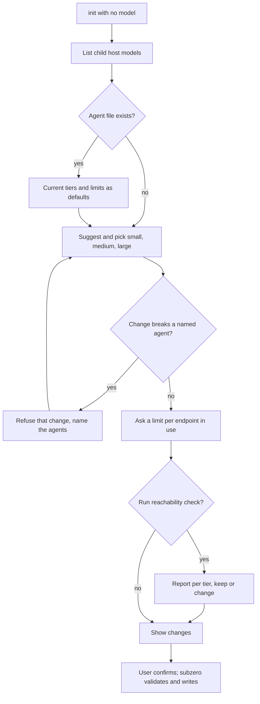
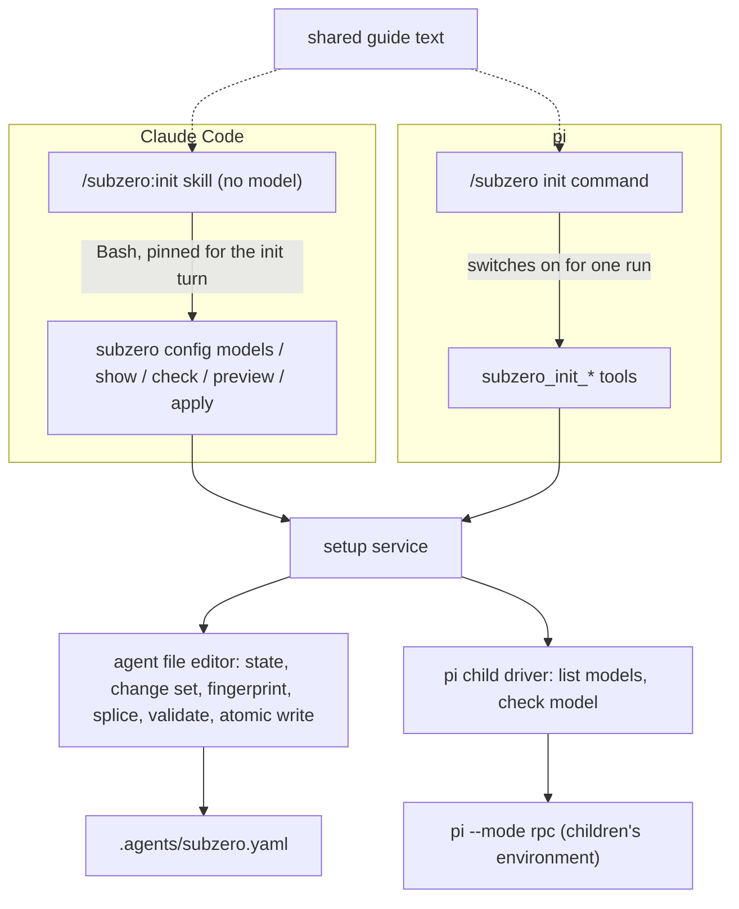
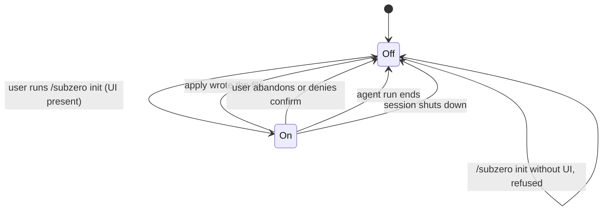

# Guided subzero init - Plan

## Goal Capsule

- **Objective:** A developer who has pi set up can enable subzero for a project, or change which models its tiers use, from inside Claude Code or pi. They should not need to know model names in advance or edit YAML by hand.
- **Means:** One shared setup service in subzero, which the Claude Code `/subzero:init` skill reaches through new `subzero config` commands, and pi reaches through a `/subzero init` command with tools that are on only for that run (KTD1, KTD2, KTD3).
- **Product authority:** The Product Contract wins on behavior. The Key Technical Decisions win on mechanism, within the Product Contract. This plan reverses the preview's "no setup machinery" decision (`docs/plans/2026-11-10-1355-feat-claude-plugin-distribution-plan.md`, line 42) for `init` only. Installing pi and setting up pi providers remain out of scope.
- **Product Contract preservation:** Changed R16: pi refreshes its tier text after a write, so only Claude Code asks for a new session (confirmed in the plan-time scoping synthesis). The brainstorm's planning questions are answered by KTD1 to KTD14, and the Dependencies note now names the RPC model listing. No other scope changes.
- **Stop conditions:** Stop and ask if a change would make subzero write `.agents/subzero.yaml` without the user's confirmation, or let an agent write it outside a user-started init run. Stop and ask if pi's RPC model listing or a one-turn check cannot run with the children's environment (KTD4, KTD9).
- **Execution profile:** Implement unit by unit in dependency order. Units U1 and U2 can proceed in parallel.
- **Open blockers:** None.

---

## Product Contract

### Summary

`subzero init` run without a model becomes a guided setup that behaves the same in Claude Code and in pi. It lists the models the child host offers and suggests a model and thinking level for `small`, `medium` and `large`. It asks a parallel limit for each endpoint the chosen models use and can test each chosen model with a one-turn prompt. Then it creates or updates `.agents/subzero.yaml`. `init <model>` stays as the quick path.

### Problem Frame

Today `/subzero:init <model>` requires the user to already know a `provider/model` name. It writes only the `medium` tier plus the `general` and `fallback` agents. The `small` and `large` tiers and the endpoint `parallel` limits must be added by hand, after reading `docs/configuration.md`. On a typical machine, `pi --list-models` lists dozens of models across several providers, and nothing helps the user pick one for each tier.

In pi it is worse. The pi parent refuses every delegation until an agent file exists, yet the pi package ships no setup path: `/subzero` only lists, attaches to and cancels tasks. A pi user with no config has to leave pi to create one.

### Actors

- A1. Developer: decides which models the tiers use and how many children each endpoint may run at once.
- A2. Parent agent: Claude Code or pi, running the guided init skill and talking with A1.
- A3. subzero: lists the child host's models, reads the current agent file, checks reachability, and writes the file.
- A4. Child host (pi): the source of the model list and the runtime the reachability check exercises.

### Key Decisions

- **Guided setup is `init` with no model, not a new command.** Every "run subzero init" error already points to it, and `init <model>` stays the scriptable quick path. Governs R1. (session-settled: user-directed — chosen over a separate `/subzero:setup` and over replacing `init` entirely: one entry point, and the existing errors stay correct.)
- **Both parents get it.** Governs R2. (session-settled: user-directed — chosen over Claude Code only and pi only: a pi user with no config must be able to recover without leaving pi.)
- **Updates touch tiers and endpoint limits only.** Governs R12. (session-settled: user-directed — chosen over adding missing entries only and over editing the whole file: a real update without the skill turning into a full config editor.)
- **The agent suggests, the user decides.** Governs R5, R7. (session-settled: user-directed — chosen over a plain picker and over auto-filling every tier: suggestions with a reason, and the user stays in control of each tier.)
- **Checking reachability is optional.** Governs R10. (session-settled: user-directed — chosen over always checking and over never checking: catches a dead server or missing key early, without forcing a cost.)
- **A change that would break the file is refused and explained.** Governs R13. (session-settled: user-directed — chosen over offering to repoint dependent agents and over writing anyway with a warning: the flow never edits hand-written agents and never leaves a file that fails to load.)
- **Parallel limits are asked per endpoint the chosen tier models use.** The file stores limits per endpoint, so two tiers on one server share one question. Governs R8, R9. (session-settled: user-approved — chosen over per-model limits, which would change the config format and the core.)
- **subzero writes the file, never the agent.** Governs R14. (session-settled: user-approved — chosen over letting the agent edit the YAML directly: the guided path gets the same checks as today's `init`, and the existing init skill's no-hand-edits rule holds.)
- **Only the user starts guided init.** The agent file is executable configuration (`docs/decisions.md` P16), so an agent must not create or rewrite it unprompted. Governs R3.

### Requirements

**Entry and parents**

- R1. Running `init` with no model starts the guided flow. Running `init <model>` keeps today's behavior unchanged.
- R2. The guided flow is available from the Claude Code plugin and from the pi package, with the same steps and outcomes on both.
- R3. The guided flow is started only by the user, never by the agent on its own initiative.

**Choosing tier models**

- R4. The flow presents the models the child host offers (for pi, what `pi --list-models` shows), so the user never has to type a model name from memory.
- R5. For each of `small`, `medium` and `large`, the agent suggests a model and thinking level with a one-line reason. The user accepts it, picks another listed model, or leaves `small` or `large` unset; `medium` is always required.
- R6. The flow offers only thinking levels that make sense for the chosen model, so a model the host lists without thinking support gets `off`.
- R7. Before `large` is set, the flow tells the user that it moves compound-engineering's session-model reviewers and plain subagent requests from Claude to the child.

**Parallel limits**

- R8. After the tiers are chosen, the flow asks one parallel limit for each endpoint the chosen tier models use, naming the tiers and models on it; a blank answer means no limit.
- R9. An endpoint limit that no tier uses after the change is removed and listed in the change summary.

**Reachability check**

- R10. Once the tiers are chosen, the flow offers to send each chosen model a one-turn prompt, then reports per tier whether it answered and lets the user keep or change any that failed; declining skips the check.

**Writing and updating**

- R11. When no agent file exists, the flow creates one holding the chosen tiers, the endpoint limits, and the `general` and `fallback` agents.
- R12. When an agent file exists, the flow starts from its current tiers and limits as defaults and changes only tiers and endpoint limits. It also adds `general` or `fallback` when missing. Other agents, skills, routing settings and comments stay as they are.
- R13. A change that would make the file fail to load, such as removing a tier a named agent uses through `tier:` or `tiers:`, is refused for that change only, naming the agents involved, and the rest of the flow continues.
- R14. subzero writes the file and validates it against the same load rules delegation uses; the agent running the skill never edits the YAML itself, and nothing is written when validation fails.
- R15. Before writing, the flow shows the full set of changes and writes only after the user confirms.
- R16. After writing, the flow reports what changed. When tiers were added or removed, Claude Code says a new session is needed, because its routing text is built once per session; pi refreshes its tier text in place.

**Documentation**

- R17. The README and `docs/configuration.md` present guided init as the first-run path, alongside `init <model>`.

### Key Flows

- F1. First-time setup
  - **Trigger:** A1 runs `init` with no model in a project with no `.agents/subzero.yaml`, from Claude Code or pi.
  - **Actors:** A1, A2, A3, A4
  - **Steps:** A3 lists A4's models; A2 suggests a model and thinking level for each tier, warning before `large`; A1 accepts or changes each; A2 asks a limit for each endpoint in use; A2 offers the reachability check and A1 accepts or declines; A2 shows the changes; A1 confirms; A3 validates and writes the file.
  - **Outcome:** A loadable agent file with `medium`, any chosen `small` and `large`, endpoint limits, and the `general` and `fallback` agents.
  - **Covered by:** R1, R2, R4 to R8, R10, R11, R14 to R16
- F2. Updating an existing file
  - **Trigger:** A1 runs `init` with no model in a project that already has an agent file.
  - **Actors:** A1, A2, A3, A4
  - **Steps:** A3 reads the current tiers and limits; A2 presents them as defaults; A1 keeps, changes, adds or removes tiers; a change that would break the file is refused and explained; limits are asked for endpoints in use and orphaned ones are dropped; A2 shows the changes; A1 confirms; A3 validates and writes.
  - **Outcome:** Only tiers and endpoint limits differ; everything else in the file is as it was.
  - **Covered by:** R8, R9, R12 to R16



### Acceptance Examples

- AE1. **Covers R1.** Given any project, when A1 runs `init local/qwen`, the command behaves exactly as today and asks no questions.
- AE2. **Covers R8.** Given A1 picks `small` = `local/qwen3-4b`, `medium` = `local/qwen3-coder-30b` and `large` = `google/gemini-3.1-pro-preview`, the flow asks two limit questions: one for `local` naming `small` and `medium`, and one for `google` naming `large`.
- AE3. **Covers R9.** Given the file has `endpoints.local` and only `medium` uses `local`, when A1 moves `medium` to a `google` model, `endpoints.local` is removed and the change summary lists it.
- AE4. **Covers R13.** Given a hand-written agent `file-facts` has `tier: small`, when A1 removes `small`, that removal is refused with a message naming `file-facts`, and A1 can still change `medium` and the limits.
- AE5. **Covers R12.** Given the file holds a hand-written agent, a `skills:` map, `routing:` settings and comments, when A1 changes the `medium` model, all of those are unchanged after the write.
- AE6. **Covers R6.** Given A1 picks a model that `pi --list-models` marks `thinking: no`, the tier gets thinking `off` and A1 is not asked for a level.
- AE7. **Covers R10.** Given A1 accepts the check and the `large` model's endpoint is unreachable, the flow reports `large` as failed and A1 picks another model or keeps it; given A1 declines, no prompt is sent.
- AE8. **Covers R7.** Given A1 is about to set `large`, the flow first states what `large` moves off Claude, and A1 can leave it unset.

### Scope Boundaries

- Installing pi, or setting up pi providers, API keys or `~/.pi/agent/models.json`. Guided init assumes pi already lists the models the user wants.
- Editing agents, skills or routing settings, including repointing an agent at another tier.
- Per-model parallel limits; limits stay per endpoint.
- Child hosts other than pi. The flow lists the models of the registered child host, and pi is the only one today.
- The agent starting guided init on its own, for example on an "agent file is missing" error.

### Dependencies / Assumptions

- The model list comes from the child host. pi's RPC `get_available_models` returns the same configured models as `pi --list-models`, with per-level thinking support and cost (KTD4). `pi --list-models` exits 0 even when nothing matches (`docs/target-claude-pi.md`).
- Suggestions combine that metadata with the agent's general knowledge of the models and may be wrong; R5 keeps the user deciding.
- The existing writer keeps comments in block-style YAML but rewrites a flow-style map (`{ ... }`) it adds entries to (`src/config/agent-config.ts`). R12's "comments stay" holds under that limit unless planning lifts it.
- pi packages can ship skills (`node_modules/@earendil-works/pi-coding-agent/docs/packages.md`); the subzero pi package declares none today.

### Sources / Research

- `skills/init/SKILL.md`: today's user-only init skill and its no-hand-edits rule.
- `src/cli/cli.ts` (`init`) and `src/config/agent-config.ts` (`addStarterEntries`, endpoint and tier load checks).
- `src/pi/driver.ts` (`prerequisites`, `starterTools`) and `src/kernel/kernel.ts`.
- `src/pi-parent/extension.ts` (`/subzero` command) and `scripts/build-pi-package.mjs` (pi package contents).
- `src/config/tier-words.ts` and the README section on what configuring a `large` tier changes.
- `docs/configuration.md`, `docs/status.md` (deferred guided setup), `docs/decisions.md` (P16).

---

## Planning Contract

### Key Technical Decisions

- KTD1. **One shared setup service serves both parents.** It owns listing models, reading the current state, checking models, previewing a change set and applying it. The Claude Code commands and the pi tools are thin wrappers over it, so the two parents cannot drift apart (R2). The conversation itself, meaning the suggestions, the question order and the large warning, lives in one shared guide text (KTD13), not in the service.
- KTD2. **Claude Code reaches the service through new `subzero config` commands with JSON output, called by the `/subzero:init` skill.** The commands are `config models`, `config show`, `config check`, `config preview` and `config apply`. They sit outside the `init` prefix, so `allowed-tools` can name each one. The change set travels as repeated flags (`--tier <name>=<model>:<thinking>`, `--unset <tier>`, `--limit <endpoint>=<n>`, `--no-limit <endpoint>`), which fit pinned Bash patterns and show the exact change in the command line. The thinking level is always required and is split off at the last colon, because pi model ids can contain colons (for example `ollama/qwen2.5-coder:7b`). The skill pins every `config` command, `apply` included, for the init turn only, and confirms once through AskUserQuestion after relaying subzero's preview unchanged (R15). Governs R14, R15. (session-settled: user-directed — chosen over leaving `apply` unpinned so Claude Code's permission prompt confirms a second time: one confirmation, and outside a user-started `/subzero:init` the write command is never pre-approved.)
- KTD3. **pi reaches the service through a `/subzero init` command whose tools are on only for that run.** The command switches on six tools (models, show, check, ask, preview, apply), then hands the agent the shared guide text. The apply tool shows the diff in `ctx.ui.confirm` itself, so subzero enforces R15 in pi. Without a UI (`ctx.hasUI` false), it refuses. The tools switch off when the run writes, is abandoned, or the agent run ends. pi commands are user-only, which satisfies R3. Governs R2, R3, R15. (session-settled: user-approved — chosen over shipping the `subzero` CLI in the pi package with a packaged pi skill: the pi package has no CLI, and pi has no permission gate on bash, so a CLI-based write would be reachable by the agent at any time.)
- KTD4. **Models come from pi's RPC `get_available_models`, run with the children's environment and pi command.** It gives per-level thinking support through `thinkingLevelMap` and cost per model, which the text table cannot (R6). Running with `CHILD_ENV` (`PI_OFFLINE=1`), the children's resource-isolation flags (`-na -ne -nc -np --no-themes -ns`) and the driver's `piCommand` makes "listed" mean "a child can reach it": providers that only extensions add, which children drop, are not listed. The listing has a bounded response timeout. Zero models is an error that points to pi provider setup (R4). Governs R4, R6. (session-settled: user-approved — chosen over parsing the `pi --list-models` text table, which has only a yes/no thinking column and no cost.)
- KTD5. **Apply is bound to its preview by a fingerprint.** Preview returns a fingerprint over the file text, or a marker for "no file", together with the normalized change set. Apply takes the change set plus that fingerprint and refuses when either the file or the change set differs from what was previewed, including a file created or deleted in the meantime. So any change made after the confirmation needs a new preview. On a refusal, the flow previews again. Apply revalidates the result with the same parser delegation uses. It writes a temp file with a random name next to the agent file, created exclusively so an existing path or symlink is never followed, removes it on failure, and renames it into place. The write must be atomic because running delegations re-read the file on every call. Governs R14, R15.
- KTD6. **The writer extends today's text-splice approach instead of re-rendering the YAML document.** New operations are: replace a tier's value, delete a tier or endpoint entry along with the comment lines directly attached to it, set a limit, and create the `endpoints:` map. This keeps every comment and line it does not touch (R12). A flow-style map that gets an entry is still rewritten, as today. Governs R12.
- KTD7. **Refusals and orphan removal follow the loader's own rules, computed from the parsed catalog.** For each tier, the show result lists every agent that uses it through `tier:` or a `tiers.<t>` override, `general` and `fallback` included. So a breaking removal is refused when the user picks it, and the refusal names every agent (R13), not just the first one the parser trips on. An endpoint counts as used when a tier model or an agent override model belongs to it. Limits on endpoints that only overrides use are kept and not asked about (R8, R9). Governs R8, R9, R13.
- KTD8. **The guided flow runs inside one agent turn on both parents.** Claude Code's `allowed-tools` grants last only for the turn that invoked the skill. So the skill asks every question through AskUserQuestion and never ends its turn mid-flow. pi mirrors this: the ask tool shows `ctx.ui.select` or `ctx.ui.input`, and the init tools switch off when the agent run ends. Re-running init restarts from the file. Governs R3, R15.
- KTD9. **The reachability check is a driver-level one-turn RPC run, not a delegation.** Delegation needs an agent entry and creates task records, and the chosen models are not written yet. The check starts pi with the children's flags, the chosen model and thinking level, `--no-tools`, no saved session and a fixed tiny prompt. It runs models one after another so a single local server is not overloaded. Each check times out after 120 seconds, to allow a cold local model to load, and can be cancelled. Each model reports answered, or failed with a one-line reason. Governs R10.
- KTD10. **Thinking levels come from the model.** The rule mirrors pi-ai's `getSupportedThinkingLevels`. A model without reasoning offers only `off`. A reasoning model offers `off` through `high` except the levels its `thinkingLevelMap` marks `null`, and offers `xhigh` or `max` only when the map gives them a non-null value. When a tier's model changes, its level is chosen again. A kept model keeps its current level. Governs R6.
- KTD11. **A broken existing file is repaired only within scope.** Missing `medium`, `general` or `fallback`, and an endpoint limit no tier uses, are fixed as part of the flow. Any other load error (YAML syntax, unknown keys, an agent naming a missing tier, a missing skill) is refused with the first error unchanged, nothing is written, and the user is told to fix the file by hand. A tier on another host, or on a model pi no longer lists, is shown as current and not listed, and is kept unless the user changes it. Governs R12, R14.
- KTD12. **`subzero init` with no model in a terminal stays a usage error.** The message now points to `/subzero:init` in Claude Code and `/subzero init` in pi, since a terminal has no agent to run the guided flow (R1). Options given without a model, such as `--thinking`, are a usage error too.
- KTD13. **One guide text, two parents.** The guided conversation lives in one tool-neutral markdown file in the init skill folder: the steps, the suggestion rules, the large warning, limit input rules and the never-hand-edit rule. The Claude Code skill maps each step to a `config` command. The pi bundle embeds the same file at build time and maps each step to a tool. The large warning sentence comes from the tier-word table, so it has one source (R7).
- KTD14. **pi gains `/subzero init <model>` as its quick path and refreshes its tier text after a write.** The quick path calls the same starter-entry writer as the CLI. After apply, the `subagent` tool description is rebuilt, because pi builds it at session start and would otherwise still say the new tiers are not configured. Governs R1, R16. (session-settled: user-approved — chosen over leaving pi without a quick path and asking pi users for a new session.)

### High-Level Technical Design

These diagrams show the intended shape. The prose in the KTDs and units is authoritative.

How the parts fit:



Preview and apply:

```mermaid
sequenceDiagram
  participant U as Developer
  participant A as Parent agent
  participant S as Setup service
  participant F as Agent file
  A->>S: show
  S->>F: read, parse
  S-->>A: tiers, limits, dependents, fingerprint
  A->>U: questions (one turn)
  A->>S: preview(change set)
  S-->>A: diff, refusals, orphaned limits, fingerprint
  A->>U: subzero's diff, confirm?
  U-->>A: yes
  A->>S: apply(change set, fingerprint)
  S->>F: re-read; fingerprint matches?
  alt changed since preview
    S-->>A: refused, preview again
  else unchanged
    S->>S: splice, validate with the load parser
    S->>F: write temp file, rename
    S-->>A: change summary
  end
```

pi tool lifecycle:



### Assumptions

- pi 1.5.2 (the installed devDependency) supports `get_available_models` with `--offline` and `--no-session`. A user on an older pi gets the error from KTD4 if the listing fails.
- `$ARGUMENTS` expands to an empty string when `/subzero:init` gets no arguments, so the skill can branch on it. The Claude Code docs say the placeholder expands to the argument string as typed but don't state the empty case, so U5 verifies it.
- An AskUserQuestion answer does not end the assistant turn, so pinned commands stay approved for the whole guided flow (KTD8). U5 verifies this.

### Deferred to Implementation

- Exact JSON field names of the `config` command output, as long as each model carries its endpoint, allowed thinking levels, context, cost and reasoning flag, and the show result carries dependents per tier and the fingerprint.
- The tiny prompt and the reply check for a reachability check, and how failures are sorted into auth, unreachable, unknown model and timeout from pi's errors.
- Whether the flow-style map limit (KTD6) can be lifted cheaply while adding the replace and delete operations.
- Whether the setup service gets its own Sigil component or extends `design/agent-config.sigil` and `design/delegation-service.sigil`. Either way, `sigil check .` must pass (U8).

### System-Wide Impact

- **Executable configuration.** `.agents/subzero.yaml` decides which models and tools children use (`docs/decisions.md` P16). The write path stays user-started on both parents (R3, KTD2, KTD3), and no MCP tool gains a write.
- **Running tasks.** Running children keep the model and limit they started with. A new limit applies from the next child admitted on that endpoint. The atomic write (KTD5) prevents a delegation from reading a half-written file.
- **Permissions.** The `/subzero:init` skill gains pinned patterns for the `config` commands. Today's `init *` pattern is unchanged, so the quick path keeps its approval.
- **Release surface.** The plugin ships the guide text inside `skills/init`, and the pi bundle embeds it. The release allowlist tests and docs tests change (U5, U6, U7).

### Risks & Dependencies

| Risk | Mitigation |
|---|---|
| The agent ends its turn mid-flow in Claude Code, so later `config` calls prompt | The guide text puts the "ask only through the question tool, never end the turn" rule first (KTD8). An unpinned call is a prompt, not a failure. |
| The agent edits the YAML directly after a refusal | The guide text forbids it, and the skill's `allowed-tools` grants no Write or Edit. A U5 check scans a scripted run for edits to the agent file. |
| A user picks "don't ask again" on some later prompt | It doesn't apply here: apply is pinned only inside the skill (KTD2), and no global allow rule is written. |
| pi's model catalog differs offline from online | The listing uses the children's environment, so it shows what children can use (KTD4). The flow tells the user to refresh pi's catalog outside subzero if a model is missing. |
| The AskUserQuestion limit of 2 to 4 options can't hold dozens of models | The guide prints the full list as text, offers the suggestion, the current model and "leave unset" as options, and accepts any listed model id typed through Other. Ids not in the list are asked again. |

---

## Implementation Units

### U1. Agent file editor: state, change sets and safe writes

**Goal:** The config layer can read the current tiers, limits and dependents, preview a change set, and apply it safely.

**Requirements:** R8, R9, R11, R12, R13, R14, R15; AE3, AE4, AE5; KTD5, KTD6, KTD7, KTD11.

**Dependencies:** None.

**Files:**
- `src/config/agent-config.ts` (lift the splice helpers out of `addStarterEntries` and export what the editor needs)
- `src/config/agent-setup.ts` (new)
- `test/config/agent-setup.test.ts` (new)
- `test/config/agent-config.test.ts`

**Approach:**
1. Add a state reader built on `readAgentText` and the catalog parser. It returns:
   - tiers with host, model and thinking;
   - limits;
   - per tier, the agents that depend on it (`tier:` and `tiers.<t>` keys, `general` and `fallback` included);
   - endpoints used only by overrides;
   - which starter entries are missing;
   - the fingerprint, or a "no file" result.

   It classifies a load failure as repairable or refused (KTD11).
2. Add a change-set model: set a tier, unset a tier, set a limit, clear a limit. Preview computes:
   - per-change refusals (`medium` cannot be unset; unsetting a tier others depend on is refused, naming them);
   - orphaned limits to drop (KTD7);
   - starter entries to add;
   - the resulting text and a readable diff.

   An empty change set reports "nothing to change".
3. Add splice operations: replace a value range, delete an entry's lines with the comments directly attached to it, set or create `endpoints.<e>.parallel`, and drop an `endpoints:` map that ends up empty.
4. Apply re-reads the file. It refuses on a fingerprint mismatch (file or change set), and on a change set that still holds a refused change. It validates the result with the catalog parser, then writes and renames per KTD5, reusing the random-name pattern of `writeAtomic` in `src/store/task-store.ts` with exclusive create.

**Patterns to follow:** `addStarterEntries` in `src/config/agent-config.ts` (splice, then `parseCatalog`, then write), `StarterHostConflictError`, and the `makeProject` and fixture helpers in `test/helpers.ts`.

**Test scenarios:**
- Happy path: with no file, a change set with `medium`, `small` and a `local` limit creates a file holding those plus `general` and `fallback` at the default 1200-second timeout, and it loads.
- Covers AE5. A file with a hand-written agent, a `skills:` map, `routing:` settings and comments: changing the `medium` model changes only that line, and the bytes of every other line are unchanged.
- Covers AE4. With `file-facts` on `tier: small`, unsetting `small` is refused with `file-facts` named. The rest of the change set previews, and an apply that still includes the unset is rejected with nothing written.
- With two agents on `small`, one through `tier:` and one through a `tiers.small` override, the refusal names both.
- Covers AE3. Moving `medium` from `local` to `google`, when no other tier uses `local`, removes `endpoints.local`, and the preview and the apply result both list it.
- An endpoint used only by an agent's override model keeps its limit, and the state marks it override-only.
- Clearing the only limit removes the `endpoints:` map.
- A limit of 0, -1, 1.5 or `two` is rejected by the change-set model.
- A file missing `fallback` previews as an update that adds it.
- A file with a YAML syntax error, an unknown key, or an agent naming a missing tier is refused with the parser's message, and nothing is written.
- `medium` on another host, or on a model the caller marks as not listed, is reported as current and kept when the change set does not touch it.
- Fingerprint: editing the file between preview and apply, creating it, or deleting it makes apply refuse, and the file is unchanged.
- An empty change set reports nothing to change and does not touch the file's modification time.
- A failure during write leaves the original file intact, with no partial file at the agent file path, and no temp file left behind.
- A symlink placed in `.agents/` beforehand does not redirect the write, and the agent file stays a regular file.

**Verification:** The new tests pass. The existing starter-entry tests still pass unchanged.

### U2. pi child driver: model listing and reachability check

**Goal:** The kernel can ask a child host for its models and for a one-turn check of a model.

**Requirements:** R4, R6, R10; AE6, AE7; KTD4, KTD9, KTD10.

**Dependencies:** None.

**Files:**
- `src/core/types.ts` (optional `listModels` and `checkModel` on the child driver)
- `src/kernel/kernel.ts`
- `src/pi/driver.ts`
- `src/pi/launch.ts` (shared flag builder for a check run)
- `test/fake-pi/fake-pi.mjs`
- `test/pi/driver.test.ts`
- `test/kernel/kernel.test.ts`

**Approach:**
1. Add optional `listModels` and `checkModel` capabilities to the child driver interface, plus kernel accessors that return undefined when a driver offers none, as `prerequisites` and `starterTools` do.
2. The pi listing starts `piCommand` with the children's resource-isolation flags (from the shared flag builder in `src/pi/launch.ts`) plus `--mode rpc --offline --no-session`, with `CHILD_ENV` and a bounded response timeout. It sends `get_available_models` and maps each model to:
   - the subzero model name `provider/id`;
   - the endpoint (the same rule as `modelEndpoint`);
   - the reasoning flag;
   - the allowed thinking levels (KTD10);
   - context, max output, input kinds and cost.
3. The pi check reuses `PiRpcClient` with the children's flags, the chosen model and thinking level, `--no-tools` and `--no-session`. It sends the fixed prompt, waits for the run to settle or the 120-second timeout, and kills pi on abort. It reports answered, or failed with a kind and a one-line message, reusing the existing unknown-model stderr match.
4. Teach the fake pi `get_available_models` and a check scenario: a reply, an unknown model, a hang, or an auth error on stderr.

**Patterns to follow:** `prerequisites` and `sessionExport` in `src/pi/driver.ts`, `PiChildRun` and `PiRpcClient` for the RPC exchange, and the `FAKE_PI_SCENARIO` fields in `test/fake-pi/fake-pi.mjs`.

**Test scenarios:**
- The listing maps two fake models to their endpoints, allowed levels and cost.
- Covers AE6. A model with `reasoning: false` allows only `off`.
- A reasoning model whose `thinkingLevelMap` marks `xhigh` and `max` as `null` allows `off` to `high` only.
- A reasoning model with no `thinkingLevelMap` allows `off` to `high` only. One whose map gives `xhigh` a value also allows `xhigh`.
- The listing runs with `PI_OFFLINE=1`, `PI_TELEMETRY=0`, the children's isolation flags and `SUBZERO_PI`'s command (checked through `FAKE_PI_LOG`).
- A fake pi that never answers the listing request fails with a timeout error, not a hang.
- Zero models returns an error that names pi provider setup. A pi that exits or prints malformed JSON returns an error, not an empty list.
- A check against a fake model that replies reports answered.
- Covers AE7. An unknown model reports failed with the unknown-model kind.
- A fake pi that never settles reports a timeout. The fake timer is shortened in tests.
- Aborting a check kills the pi process, and no process stays running.
- The kernel returns undefined for both capabilities on a driver without them, and throws for an unknown host.

**Verification:** The driver and kernel tests pass. A manual run against the real pi lists the same models as `pi --list-models` run with the children's environment and isolation flags.

### U3. Setup service

**Goal:** One service gives both parents the five setup operations over U1 and U2.

**Requirements:** R2, R4, R7, R10, R14; KTD1, KTD13.

**Dependencies:** U1, U2.

**Files:**
- `src/service/setup-service.ts` (new)
- `src/config/tier-words.ts` (add the sentence on what `large` moves off Claude)
- `test/service/setup-service.test.ts` (new)

**Approach:**
1. `models` runs the host's prerequisites check, then `listModels`.
2. `show` returns the U1 state annotated with whether each current tier model is listed, plus the large warning sentence from the tier-word table.
3. `check` runs `checkModel` for each requested model, sequentially.
4. `preview` and `apply` pass through to U1 with the project root the service already holds.
5. The host is chosen as `init` chooses it today: the single registered host, or the one named.

**Patterns to follow:** The `DelegationService` constructor and project-root handling, and `src/service/status-text.ts` for shared wording.

**Test scenarios:**
- `models` with pi missing returns the prerequisites message and never runs the listing.
- `show` marks a tier whose model is missing from the listing as not listed.
- `show` includes the large warning sentence, with the same text the tier-word table holds.
- `check` on three models runs them one after another (the fake pi log shows no overlap) and returns a result for each.
- `preview` and `apply` act on the service's project root, not the process working directory.

**Verification:** The service tests pass using the fake pi and temp projects.

### U4. CLI `subzero config` commands

**Goal:** Claude Code's skill can call the setup service through `bin/subzero` with JSON results.

**Requirements:** R1, R14, R15; KTD2, KTD12.

**Dependencies:** U3.

**Files:**
- `src/cli/cli.ts`
- `test/cli/config.test.ts` (new)
- `test/cli/cli.test.ts`

**Approach:**
1. Add the `config` verb with the subcommands `models`, `show`, `check <model>:<thinking>...`, `preview <changes>` and `apply --expect <fingerprint> <changes>`. Each prints one JSON document to stdout.
2. Parse changes from the repeated flags in KTD2, splitting model and thinking at the last colon. A malformed flag is a usage error with exit 2. A refusal (fingerprint mismatch, refused change, load error) prints JSON with the reason and exits 1.
3. Change bare `init` with no model to a usage error that names `/subzero:init` and `/subzero init` (KTD12). Update the existing test that asserts exit 2 to also check the new wording.
4. Extend the usage text.

**Patterns to follow:** `parseNamed`, `knownError` and the `init` handler in `src/cli/cli.ts`, and the in-process `runCli` tests with captured output in `test/cli/cli.test.ts`.

**Test scenarios:**
- `config models` prints JSON listing the fake models.
- `config show` on a project with no file prints a "no file" state and a fingerprint.
- `config preview --tier medium=local/q:medium --limit local=1` prints the diff and the fingerprint without touching the file.
- `config apply --expect <fp>` with the same flags writes the file. With a stale fingerprint it exits 1, prints the reason, and the file is unchanged.
- `config apply --expect <fp>` with flags that differ from the previewed ones exits 1, and the file is unchanged.
- `--tier medium=ollama/qwen2.5-coder:7b:off` and `config check ollama/qwen2.5-coder:7b:off` parse to the model `ollama/qwen2.5-coder:7b` with thinking `off`.
- `--tier small=local/q:turbo` (an invalid level), `--tier small=local/q` (no level) and `--limit local=0` are usage errors with exit 2.
- `init` with no arguments exits 2, and the message names both parent commands.
- `init --thinking high` with no model exits 2.
- `init local/qwen` behaves exactly as before (AE1), including the existing "already there" output.

**Verification:** The CLI tests pass. Running `bin/subzero config models` against the real pi prints valid JSON.

### U5. Guide text and the Claude Code `/subzero:init` skill

**Goal:** `/subzero:init` with no model runs the guided flow, and `/subzero:init <model>` keeps the quick path.

**Requirements:** R1, R3, R4, R5, R7, R8, R10, R15, R16; F1, F2, AE1, AE2, AE8; KTD2, KTD8, KTD13.

**Dependencies:** U4.

**Files:**
- `skills/init/SKILL.md`
- `skills/init/guided-init.md` (new; the shared guide text)
- `test/release/build-plugin.test.ts`
- `test/release/docs.test.ts`

**Approach:**
1. Write the guide text so the standing rules come first:
   - ask every question with the blocking question tool and never end the turn mid-flow;
   - never create or edit the agent file; only the apply step writes;
   - relay subzero's preview unchanged and confirm once before applying;
   - if apply is refused, preview again; never retry a refused change.

   Then the steps:
   - list models, showing the full list as text;
   - per tier, suggest a model and thinking level with a one-line reason; current values are the defaults on update, and the large warning comes first;
   - ask a limit for each endpoint in use, naming its tiers and models;
   - offer the check;
   - preview, confirm, apply;
   - report, saying a new session is needed when tiers were added or removed.
2. In the skill:
   - keep `disable-model-invocation: true`;
   - make the model optional in `argument-hint`;
   - with a model, keep today's instructions;
   - with no model, map each guide step to a `config` command and follow the guide;
   - run `config check` once per chosen model with the Bash tool timeout set to 180000 ms, because one check can take up to 120 seconds plus pi start-up, past Bash's 120-second default;
   - pin `init *` and each `config` command in `allowed-tools`.
3. Confirm the plugin allowlist ships the new file. It ships the whole `skills/init` folder.

**Patterns to follow:** The `allowed-tools` strings in `skills/init/SKILL.md` and `skills/tasks/SKILL.md`, and the docs tests that pin skill wording.

**Test scenarios:**
- The built plugin contains `skills/init/guided-init.md`, and `SKILL.md` references it.
- `allowed-tools` holds the unchanged `init *` pattern plus one pattern for each `config` command, and no Write or Edit.
- The guide text contains the large warning sentence from the tier-word table (a test reads both and compares them).
- Manual smoke check in Claude Code, recorded in the PR:
  - `/subzero:init` with no model in an empty project completes F1 using only AskUserQuestion, with no permission prompts and no Write or Edit on the agent file;
  - `/subzero:init local/qwen` behaves as today (AE1);
  - the run confirms that `$ARGUMENTS` is empty with no model and that the grants last across the questions (Assumptions).
- Covers AE2. In the manual run with `small` and `medium` on `local` and `large` on `google`, exactly two limit questions are asked.

**Verification:** The release tests pass, and the manual smoke run is recorded in the PR.

### U6. pi `/subzero init` command and init tools

**Goal:** pi users get the same guided flow and quick path from inside pi.

**Requirements:** R1, R2, R3, R10, R15, R16; F1, F2; KTD3, KTD8, KTD13, KTD14.

**Dependencies:** U3, U5 (guide text).

**Files:**
- `src/pi-parent/init.ts` (new)
- `src/pi-parent/extension.ts`
- `src/pi-parent/main.ts`
- `build.mjs` (embed the guide text in the pi bundle)
- `test/pi-parent/init.test.ts` (new)
- `test/pi-parent/fake-pi-api.ts` (add `select`, `input` and `confirm` stubs)
- `test/release/build-pi-package.test.ts`

**Approach:**
1. Add the `init` action to `/subzero` and to its usage text.
   - With a model, it calls the starter-entry writer for the session's project root and notifies the result.
   - With no model, it refuses when `ctx.hasUI` is false. Otherwise it registers or activates the six tools, then sends the guide text as a user message.
2. The tools call the setup service built in `main.ts` from the same kernel.
   - `ask` shows `ctx.ui.select` (with an "other" entry that falls back to `ctx.ui.input`) or `ctx.ui.input`.
   - `apply` shows subzero's diff in `ctx.ui.confirm` and applies only on yes.
3. Turn the tools off after a successful apply, a denied confirm, the end of the agent run, or session shutdown.
4. After a successful apply, rebuild the `subagent` description through the existing tier-description code.

**Patterns to follow:** The `/subzero` command handler and `session_start` description builder in `src/pi-parent/extension.ts`, `pi.setActiveTools`, and the existing fake pi API in tests.

**Test scenarios:**
- Before `/subzero init`, none of the init tools are active. After it, all six are active.
- `/subzero init` in a session without UI is refused with a message naming `/subzero init <model>`, and no tools are activated.
- `/subzero init local/qwen` writes the starter entries, and a second run reports "already there".
- The apply tool with confirm answered no writes nothing and turns the tools off.
- The apply tool with confirm answered yes writes the file, turns the tools off, and rebuilds the `subagent` description to list `medium` as configured.
- Ending the agent run with the tools active turns them off.
- Session shutdown turns them off.
- Parity: the same change set applied through the CLI command and through the pi apply tool, on copies of one project, produces byte-identical files.
- The pi bundle contains the guide text, and the package still ships only its allowed files.

**Verification:** The pi-parent and release tests pass. A manual run in pi of `/subzero init` on an empty project completes F1 and is recorded in the PR.

### U7. Errors and documentation

**Goal:** Users and agents are pointed to guided init in both parents.

**Requirements:** R17; KTD12.

**Dependencies:** U5, U6.

**Files:**
- `src/config/agent-config.ts` (the missing-file and missing-entry messages)
- `README.md`
- `docs/configuration.md`
- `docs/status.md`
- `CHANGELOG.md`
- `test/release/docs.test.ts`
- `test/release/configuration-doc.test.ts`
- `test/config/agent-config.test.ts`

**Approach:**
1. Change the "run subzero init" endings so they name `/subzero:init` in Claude Code and `/subzero init` in pi.
2. In the README and `docs/configuration.md`, make guided init the first-run path and keep `init <model>` as the quick path.
3. Document the `config` commands.
4. Move "a guided `/subzero:setup`" out of the deferred list in `docs/status.md`.
5. Add a CHANGELOG entry.

**Patterns to follow:** The current wording style of `docs/configuration.md` and the pinned phrases in the docs tests.

**Test scenarios:**
- The missing-file error names both parent commands.
- The docs tests pin `/subzero:init` with an optional model and mention `/subzero init` for pi.

**Verification:** The docs and config tests pass.

### U8. Sigil design contracts

**Goal:** The design contracts describe the guided path, so `sigil check .` stays clean.

**Requirements:** R1, R2, R12, R14; KTD1 to KTD14.

**Dependencies:** U1 to U6.

**Files:**
- `design/agent-config.sigil`
- `design/cli.sigil`
- `design/kernel.sigil`
- `design/pi-driver.sigil`
- `design/pi-extension.sigil`
- the setup service contract (see Deferred to Implementation)
- `// @sigil implements` markers in the new source files

**Approach:**
1. Revise these statements in `design/agent-config.sigil`:
   - "writes that file only to add the starter entries";
   - "leave each existing line unchanged except when adding".

   The editor may now replace and delete tier and endpoint entries, and every line it does not change stays as it was.
2. Add the `config` commands and the bare-`init` usage error to `design/cli.sigil`.
3. Add the model listing and check offerings to the kernel and pi driver contracts.
4. Add the `init` action and its lifecycle to `design/pi-extension.sigil`.

**Patterns to follow:** The existing contract style and the `sigil:sigil-write` and `sigil:sigil-align` skills.

**Test expectation:** none, because these are design documents. `sigil check .` is the gate.

**Verification:** `sigil check .` reports no diagnostics, and every new source file carries an implements marker.

---

## Verification Contract

| Gate | Command or check | Applies to |
|---|---|---|
| Types | `npm run typecheck` | All units |
| Unit and release tests | `npm test` | All units |
| Build | `npm run build` | All units |
| Plugin package | `npm run release:build` (allowlist and skill files) | U5, U7 |
| pi package | `npm run release:pi:build` (bundle embeds the guide; allowed files only) | U6 |
| Design contracts | `sigil check .` reports no diagnostics | U8 |
| Manual: Claude Code | `/subzero:init` with no model in an empty project, then again to change `medium` and remove `small` (F1, F2, AE2, AE4); `/subzero:init local/qwen` (AE1) | U5 |
| Manual: pi | `/subzero init` with no model in an empty project (F1); `/subzero init local/qwen` | U6 |

---

## Definition of Done

- Every unit's verification holds, and all gates in the Verification Contract pass.
- Every acceptance example (AE1 to AE8) is covered by an automated test or by the recorded manual runs.
- A scripted Claude Code run and a pi run show no direct edit of `.agents/subzero.yaml` by the agent. Only the apply step writes.
- `init <model>` behaves as before in the CLI and in Claude Code.
- The README, `docs/configuration.md`, `docs/status.md` and `CHANGELOG.md` describe the guided path.
- Code from abandoned approaches is removed from the diff.
