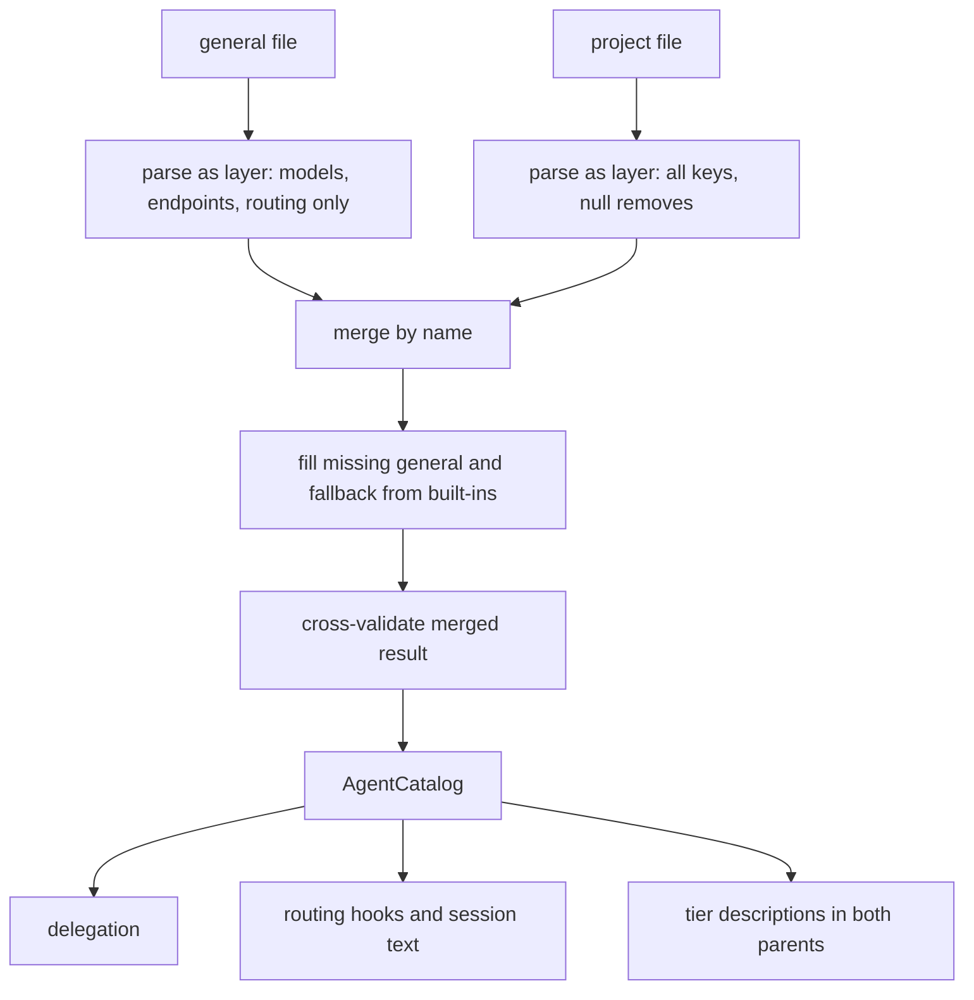

# General Config With Project Override - Plan

## Goal Capsule

- **Objective:** A person sets up subzero's model choices once, and every project they open uses them unless that project says otherwise.
- **Means:** Load a general file and the project file as two layers, merge them by name, then validate the result once (KTD1).
- **Product authority:** The user's decisions in the brainstorm dialogue, recorded under Key Decisions. Surrounding work (personal per-project overrides, skill manifests) is not active scope.
- **Execution profile:** Code change in the config loader, its consumers, the setup editor, the CLI, and both parents' guided init, plus docs and Sigil contracts. Test-first for the loader (U1), because every later unit depends on its merge rules.
- **Open blockers:** None.

## Product Contract

**Product Contract preservation:** restructured, no scope change. R6 is reworded to the per-name reading its second sentence already states. The four planning questions the brainstorm deferred are resolved in KTD2, KTD3, KTD4 and U2. R8's "every project" means every project that is on: a project with `enabled: false` never reads the general file (KTD5).

### Summary

One general file in the user's home folder holds the model tiers, parallel limits and routing settings that every project inherits. A project file lists only what differs. With a medium tier in the general file, subzero works in any project that has no file of its own, using the same starter agents that `init` writes today. A project can switch subzero off. Guided init asks whether to write for all projects or for this one.

### Problem Frame

Each project needs its own `.agents/subzero.yaml`, although the choices that file mostly holds are the same everywhere: which model is small, medium and large, and how many children may run at once on each endpoint. Setting these up again in every project is repeated work, and a project without the file gets no subzero at all.

`docs/design.md` §4.1 already plans a user-level file at `~/.agents/subzero.yaml`, and `docs/configuration.md` lists layering under "Not supported yet". Today the loader reads only the project file (`src/config/agent-config.ts`).

### Requirements

**General file and merge**

- R1. subzero reads a general file at `~/.agents/subzero.yaml` and layers the project's `.agents/subzero.yaml` over it.
- R2. The general file holds only `models.tiers`, `endpoints.<endpoint>.parallel` and `routing`. Any other key in it is refused with an error that names the file and the key.
- R3. Tiers merge by tier name, limits by endpoint, and routing by key. A project entry replaces the general entry of the same name whole, so a project `medium` replaces model and thinking together. Entries the project does not name are inherited.
- R4. A project can remove an inherited tier or limit. The syntax is a planning decision.

**Activation and agents**

- R5. subzero is on in a project when the merged configuration has a `medium` tier, with or without a project file. With no `medium` tier it stays off, as it does today.
- R6. Each of `general` and `fallback` that the project does not define comes from a built-in starter agent: the starter tools of the `medium` tier's child host, and a timeout of 1200 seconds. A project agent with the same name replaces the built-in one.
- R7. `enabled: false` in a project's `.agents/subzero.yaml` switches subzero off there, in the same way a project with no file is off today: no hooks, no routing text, and every subagent runs on Claude.

**Errors**

- R8. A load error says which file it comes from, the general file or the project file. A broken general file fails the load in every project.

**Guided init and show**

- R9. Guided init asks first whether the chosen models are for every project or only this one, then keeps its current steps, one preview, one confirm and the fingerprint check, and writes the file that was chosen. If the general file does not exist, the all-projects choice creates it.
- R10. When a change written to the general file would be overridden in this project, init says so before the confirm.
- R11. `show` marks each tier and limit as coming from the general file or from this project.
- R12. The `init <model>` quick path in both parents is unchanged: it writes the project file as it does today.
- R13. The `subzero config` commands that back guided init take the same all-projects or this-project choice.

### Key Decisions

- **The general file holds tiers, limits and routing, and nothing else.** Agents and skills stay in the project, so a home-folder file cannot hand every repo tool access or skill paths. Governs R2. (session-settled: user-directed — chosen over tiers and limits only, and over the whole file: the user wanted routing set once as well.)
- **subzero is on everywhere once the general file has a medium tier, using built-in starter agents.** This reverses today's "no project file means off". Governs R5, R6. (session-settled: user-directed — chosen over staying off until a project opts in, and over a once-per-project confirm: no per-project setup at all.)
- **Merge by name, with the project entry replacing the general entry whole.** The project file lists only what differs, and a model can never keep a thinking level picked for another model. Governs R3. (session-settled: user-directed — chosen over field-by-field merging and over replacing whole sections.)
- **Init asks once, all projects or this project.** Governs R9, R10, R13. (session-settled: user-directed — chosen over always writing the project file and over always writing the general file.)
- **`enabled: false` in the project file is the opt-out.** It matches the key sketched in `docs/design.md` §4.1. Governs R7. (session-settled: user-directed — chosen over no opt-out and over an exclusion list in the general file.)

### Key Flows

- F1. First-time setup
  - **Trigger:** The user runs guided init in any project, with no general file.
  - **Steps:** Init asks all projects or this one; the user picks all projects; the usual model, thinking and limit questions follow; init previews the general file, the user confirms once, init writes it.
  - **Outcome:** Every project now runs subzero on those models without a file of its own.
  - **Covered by:** R5, R6, R9
- F2. One project differs
  - **Trigger:** The user runs guided init in a project that needs a different `medium` model.
  - **Steps:** Init asks all projects or this one; the user picks this project; the preview shows only the changed tier; the user confirms.
  - **Outcome:** The project file holds that one tier, and everything else is inherited.
  - **Covered by:** R3, R9

### Acceptance Examples

- AE1. **Covers R3.** Given a general file with `small`, `medium` and `large` and a limit for `local`, and a project file with only a `medium` tier and a limit for `local`, the project runs its own `medium` model and `local` limit, and the general `small` and `large`.
- AE2. **Covers R5, R6.** Given a general file with a `medium` tier and a project with no `.agents/subzero.yaml`, a delegation to `general` runs on the `medium` tier, with the starter tools of its child host.
- AE3. **Covers R5.** Given a general file with no `medium` tier and a project with no file, subzero is off in that project.
- AE4. **Covers R7.** Given a general file with a `medium` tier and a project file that holds only `enabled: false`, the project's subagents run on Claude and no routing text is added.
- AE5. **Covers R2, R8.** Given a general file with an `agents` key, loading fails in every project with an error that names the general file and the key.
- AE6. **Covers R10.** Given a project that overrides `medium`, when the user sets `medium` for all projects, init says that this project keeps its own `medium` before the confirm.

### Success Criteria

- A new project needs no setup to run on the user's chosen models.
- A user sets up models once through guided init, without editing a file by hand.
- A reader of `show` can tell from which file each value comes.

### Scope Boundaries

**Deferred for later**

- A personal, gitignored override file per project (`subzero.local.yaml`).
- Skill-shipped agent definitions and skill manifests.
- A general file that holds agents or skills.

**Deferred to Follow-Up Work**

- Asking about routing in guided init. Routing in the general file is edited by hand; init keeps its tiers-and-limits questions.

**Outside this change**

- Changing how the child hosts are chosen, or the guided init question flow beyond the added first question.

### Dependencies / Assumptions

- `docs/design.md` §4.1 plans the general file at `~/.agents/subzero.yaml`, with the project file layered over it.
- **Assumption:** refusing other keys in the general file (R2) is chosen over silently ignoring them, because silently ignored agents in a home file would look like a working setting. This was not confirmed in the dialogue.
- **Assumption:** the `init <model>` quick path stays project-only (R12). It adds the starter agents, which belong to a project.
- `docs/configuration.md` and the Sigil contracts in `design/` describe one file per project and are updated in U6.

### Sources / Research

- `src/config/agent-config.ts`: the loader reads only `.agents/subzero.yaml`, and requires the `medium` tier, `general` and `fallback`.
- `src/pi/driver.ts`: the starter tools for the pi child host.
- `docs/configuration.md` ("Where the file lives", "Not supported yet") and `docs/design.md` §4.1.
- `docs/plans/2026-11-16-1601-feat-guided-subzero-init-plan.md`: the guided init this change extends.

---

## Planning Contract

### Key Technical Decisions

- KTD1. **Parse each file as a layer, merge, then validate the merge once, from text.** `parseCatalog` splits into a per-file step (syntax, field rules, the keys each layer may hold) and a cross-reference step that runs on the merged result (an agent's `tier:` and `tiers.<t>` overrides, the limit-needs-a-model rule, the required entries). A text-based entry, `buildCatalog(generalText, projectText, options)`, runs parse, merge, built-ins and cross-validation on text that is not yet on disk. The disk-reading `loadCatalog`, the setup editor's classify and post-edit validation, and `addStarterEntries` all call it, so a file guided init wrote (a lone tier, a null removal, `enabled`) is never refused by a single-file rule. `parseCatalog` stays as the single-file call for existing tests. The project file is read first, and `enabled: false` returns before the general file is read (KTD5). Errors from the per-file step name their file; a cross-reference error names the file of the entry that holds the broken reference (an agent) or the project file for a removed tier. Governs R1, R3, R8.
- KTD2. **The general file path is `~/.agents/subzero.yaml`, overridable with `SUBZERO_GENERAL_CONFIG`.** The variable holds a full file path; an empty value counts as unset, as `SUBZERO_PROJECT_DIR` does. A missing general file means no general layer. An unreadable or malformed one is a load error naming it. The test suite sets the variable to a path that does not exist, in a Vitest setup file, so a developer's real home file never leaks into a test. Governs R1, R8.
- KTD3. **A project removes an inherited entry by naming it with no value.** `models.tiers.large:` and `endpoints.local:` with nothing after the colon remove that tier or limit for the project. Only the project layer accepts it. A tier removed this way that an agent still names is the usual dependent-agent load error. Governs R4.
- KTD4. **An inherited limit that no merged tier or override uses is ignored, not an error.** Without this, a project that moves every tier off an endpoint would fail to load because of the general file. A limit the project writes itself and that no model uses stays the load error it is today. Governs R3, R8.
- KTD5. **Off has one shape.** A project with no file and no merged `medium` tier raises `MissingAgentFileError`, as today. `enabled: false` raises a new `ProjectDisabledError`, a subclass of it, so every consumer that already treats the missing file as off (the MCP pass-back, the routing hooks) treats the disabled project the same way. `enabled: false` is checked first: before the general file is read, so a broken general file cannot reach a disabled project, and before the `medium` requirement, so a file holding only `enabled: false` is off with or without a general file. Any other project file that exists and has no merged `medium` tier stays the load error it is today. Governs R5, R7.
- KTD6. **Built-in agents come from an optional provider the loader is given, and fill each missing entry by name.** The loader takes `starterAgents(host)`, which returns the starter tools of that child host, and fills each of `general` and `fallback` the project does not define, whatever other agents it defines. Only `DelegationService.chooseAgent` passes the kernel's `starterTools`. `configuredTierNames`, `routableTiers`, `getRouting` and `listAgentNames` return no tools, so they always fill with a placeholder (an agent entry needs at least one tool); that covers the hooks, the MCP server's tier lookups and both parents' tier descriptions, none of which has a kernel. A load called with no provider at all, as the existing single-file tests do, keeps today's required-entry errors. The built-in `general` and `fallback` carry no skills and a timeout of 1200 seconds, the same value `DEFAULT_SETUP_TIMEOUT` already holds. When the child driver offers no starter tools, the load fails with the error that already names the host. Governs R6.
- KTD7. **Guided init writes tiers and limits only, and never agents.** The built-ins cover `general` and `fallback`, so a guided write adds nothing to a project file beyond the changes the user chose. This is what makes the F2 preview show only the changed tier. In the setup editor it means `plan()` stops adding agents, `addedStarter`, `missingStarter` and the starter tools and timeout leave the preview and the snapshot, a missing `general` or `fallback` is no longer a repairable problem, and the `no_starter_tools` refusal no longer applies to a guided preview. The `init <model>` quick path (R12) still writes the starter entries through `addStarterEntries`. (session-settled: user-approved — proposed with its trade-off in the scoping synthesis; the user confirmed it.) Governs R9, R12.
- KTD8. **The setup editor gets a scope, `general` or `project`, default `project`.** The scope picks the target file, the validation (both scopes build the merged catalog from the candidate text, KTD1), and the `medium` check (the merged tiers count). A general-scope preview also builds the catalog of the current project with the candidate general text: it computes tier dependents from that project's agents, refuses a change those agents depend on with the usual dependent-agent message, and reports the result invalid when the project would no longer load. Other projects are not checked; they fall under R8. Fingerprints cover the target file text, the change set and the scope, so a stale preview is still refused. `show` always reads both layers. A general-scope preview also reports the changes this project overrides, which init reads out before the confirm. Governs R9, R10, R11, R13.
- KTD9. **The `subzero config` commands take `--scope general|project`, default `project`.** A caller that passes no scope keeps its flag parsing and its output shape; what a preview or apply writes changes per KTD7. `show` takes no scope and returns both layers with a source on every value. Governs R11, R13.

### High-Level Technical Design

The activation outcome is decided by three facts: whether the merged configuration has a `medium` tier, whether the project has a file, and whether that file disables subzero.

| General file `medium` | Project file | Result |
|---|---|---|
| any | has `enabled: false` | off, the general file is not read (AE4) |
| present | none | on, built-in agents (AE2) |
| present | otherwise valid | on, project entries override by name (AE1) |
| absent | none | off (AE3) |
| absent | has a `medium` tier | on, as today |
| absent | exists, no `medium` | load error, as today |
| any | exists but does not load | load error naming the file (R8) |

### Risks & Dependencies

- **A developer's real home file leaks into tests.** Mitigated by KTD2's setup file, set up before any other work in U1.
- **Behavior reversal.** A user who writes a general file now gets subzero in every repo (Key Decisions). Documented in U6 with `enabled: false` as the way out.
- **Broken general file blocks every project that is on.** Required by R8; a project with `enabled: false` never reads it (KTD5). The error text names the file and says to fix or move it.
- **The hooks run as separate processes per call** and have no kernel (KTD6), so a hook-side loader that needed the driver registry would break them. The placeholder provider avoids that.
- **Session text is built once.** A change to the general file applies to the next delegation, because the file is re-read per call, but the routing text and the pi tier description are built at session start, as they are today. U6 documents it.

---

## Implementation Units

### U1. Layered loader

- **Goal:** `AgentCatalog` is built from the general file and the project file, with merge by name, removal by null, `enabled`, built-in agents, and file-attributed errors.
- **Requirements:** R1, R2, R3, R4, R5, R6, R7, R8.
- **Dependencies:** none.
- **Files:** `src/config/agent-config.ts`, `test/config/agent-config.test.ts`, `vitest.config.ts`, `test/setup.ts` (new), `test/release/shim.test.ts`, `test/helpers.ts`.
- **Approach:**
  - Add the Vitest setup file first and point `SUBZERO_GENERAL_CONFIG` at a path that does not exist (KTD2). A test that spawns a process with an explicit environment (`test/release/shim.test.ts` passes only `HOME`; `fakePiEnv` in `test/helpers.ts`) carries the variable too, because the setup file reaches only this process.
  - Split the parse into the per-file step and the cross-reference step (KTD1); keep `parseCatalog(text, agentFile, options)` as the single-file entry.
  - Add a `GENERAL_FILE` resolver, the text-based `buildCatalog` and the disk-reading `loadCatalog(projectRoot, options)` (KTD1). `loadAgentFile`, `getAgent`, `listAgentNames`, `configuredTierNames`, `routableTiers` and `getRouting` call `loadCatalog` and keep their signatures; the last four fill built-ins with the placeholder (KTD6).
  - The general layer accepts `models.tiers`, `endpoints` and `routing` only (R2); the project layer additionally accepts `enabled` (a boolean), skills, agents, and null values on tiers and limits (KTD3).
  - Drop inherited limits with no model (KTD4); fill missing `general` and `fallback` from `starterAgents` (KTD6); raise the off errors of KTD5.
- **Patterns to follow:** the existing `LoadError` subclasses and `validateTier`/`validateRouting` messages in `src/config/agent-config.ts`.
- **Test scenarios:**
  - Covers AE1. General `small`, `medium`, `large` and a `local` limit; project `medium` and a `local` limit: effective `medium` is the project's whole entry, `small` and `large` are the general ones, the `local` limit is the project's.
  - Covers AE2. General `medium`, no project file: the catalog loads, `general` and `fallback` are the built-ins with the provider's tools and a 1200 second timeout.
  - Covers AE3. General without `medium`, no project file: raises `MissingAgentFileError`.
  - Covers AE4. General `medium`, project file `enabled: false`: raises `ProjectDisabledError`, which is a `MissingAgentFileError`. The same with a broken general file, and with no general file and no `medium` anywhere: still `ProjectDisabledError`, because the general file is never read.
  - Covers AE5. General file with `agents:`: load error naming the general file and the key; the same for `skills:` and an unknown key.
  - Project removes `large` with `large:` empty: the merged tiers lack `large`; an agent with `tier: large` fails with the dependent-agent error.
  - Project removes the `local` limit with `local:` empty: the merged limits lack it.
  - A project `general` agent replaces the built-in `general`; the built-in `fallback` stays. A project that defines only a `helper` agent gets both built-ins.
  - Project `routing.hook: false` replaces the general `routing.hook: true`; unnamed routing keys are inherited.
  - An inherited limit for an endpoint that the project's tiers no longer use loads without error; the same limit written in the project file fails as it does today.
  - A project agent with `tier: small` when only the general file defines `small` loads; with no such tier anywhere it fails naming the project file.
  - Malformed YAML in the general file: the error names the general path; in the project file, the project path.
  - A project file with no `medium` anywhere and a general file without one: the existing load error, not the off error.
  - `SUBZERO_GENERAL_CONFIG` set to a path overrides the home path; set to empty counts as unset.
  - The child driver offers no starter tools: the load fails naming the host.
  - A load with no provider and no general file keeps today's errors, including "the fallback agent is required" for a file with `general` and no `fallback`; the existing single-file tests keep their expectations.
- **Verification:** The loader returns the merged catalog for every row of the activation table, and no existing single-file loader test changes its expectation.

### U2. Consumers use the layered loader

- **Goal:** Delegation, hooks, session text and both parents' tier descriptions behave per the activation table, with the off errors treated as off.
- **Requirements:** R5, R6, R7.
- **Dependencies:** U1.
- **Files:** `src/service/delegation-service.ts`, `src/routing/routing.ts`, `src/mcp/server.ts`, `src/pi-parent/extension.ts`, `test/service/delegation-service.test.ts`, `test/routing/routing.test.ts`, `test/routing/agent-hook.test.ts`, `test/mcp/server.test.ts`, `test/wiring/wiring.test.ts`.
- **Approach:**
  - `DelegationService.chooseAgent` passes the kernel's `starterTools` as the built-in provider (KTD6). The other call sites need no change beyond U1, because their loader functions fill the placeholder themselves: the `delegate` tool's tier lookup and tool-list description in `src/mcp/server.ts` (`configuredTierNames`, `routableTiers`) and the `subagent` execute path in `src/pi-parent/extension.ts`.
  - `routingContext` in `src/routing/routing.ts` drops its `existsSync` check on the project file and treats `MissingAgentFileError` (and its subclass) as "add nothing"; the other load errors still produce the warning, now with the file the error names rather than the fixed project path.
  - The agent hook and the session-start hook pass the placeholder provider.
  - `src/mcp/server.ts` keeps its pass-back for `MissingAgentFileError`; the disabled message names `enabled: false`.
  - `src/pi-parent/extension.ts` reads tier names through the same loader; an off error falls back to its base description, as a load error does today.
- **Patterns to follow:** the existing catch of `MissingAgentFileError` in `src/mcp/server.ts` and `routingContext`'s error handling.
- **Test scenarios:**
  - Covers AE2. A project with no file and a general `medium`: a delegation runs on the `medium` tier's model and host.
  - Covers AE4. `enabled: false`: `delegate` is passed back to Claude, `routingContext` returns nothing, and the agent hook allows every spawn.
  - A general `medium` and no project file: `routingContext` returns the routing text with the general tiers.
  - A broken general file: `routingContext` returns the warning that names the general file path.
  - A project with `enabled: false` and a broken general file: the disabled project is off, and the broken general file does not warn there (the off check comes first, KTD5).
  - Changed expectation: the `routing.test.ts` case "warns when required entries are missing" (a project file with a `medium` tier and only a `helper` agent) now loads and routes, because the built-ins fill `general`.
  - Integration: an MCP `delegate` call with only a general file and no project file runs on the `medium` tier; the `delegate` tool's own tier lookup does not fail before the service is reached.
  - Integration: the wiring test runs one delegation end to end against the fake pi with only a general file.
- **Verification:** The Claude-side hooks and the delegate tool follow the activation table, and no consumer reads the project file path by itself.

### U3. Setup editor scope

- **Goal:** The editor reads both layers, writes either file, and reports what a general write would not change here.
- **Requirements:** R9, R10, R11, R4.
- **Dependencies:** U1.
- **Files:** `src/config/agent-setup.ts`, `test/config/agent-setup.test.ts`.
- **Approach:**
  - `readSetupState`, `previewChanges` and `applyChanges` take a `scope` (KTD8). `SetupSnapshot` gains a `source` on each tier and limit and, for a tier or limit the project overrides, the general value it replaced.
  - Both scopes validate through `buildCatalog` on the candidate text and add no agents (KTD1, KTD7); `classify`, `plan()` and the post-edit check use it instead of the single-file `parseCatalog`.
  - Apply KTD7 to the editor: `plan()` stops adding agents, `addedStarter`, `missingStarter` and the starter tools and timeout leave the snapshot and preview, and a missing `general` or `fallback` is not a repairable problem.
  - A general-scope preview also builds this project's catalog with the candidate general text (KTD8) and refuses a change this project's agents depend on.
  - The `medium` refusal reads the merged tiers.
  - Removing an inherited tier or limit at the project scope writes the null entry (KTD3); removing a project-only entry deletes it as today.
  - A general-scope preview lists the changes this project overrides (R10), and the fingerprint covers the target text, the changes and the scope.
  - Creating the general file creates `~/.agents/` if needed, with the same atomic write.
- **Patterns to follow:** `plan`, `spliceTiers`, `deleteEntries` and `writeAtomic` in `src/config/agent-setup.ts`.
- **Test scenarios:**
  - Covers AE6. General-scope preview of `medium` in a project that overrides `medium`: the preview lists that this project keeps its own.
  - Creating the general file from nothing: the preview diff is against `/dev/null`, the write creates the folder and the file, and a second preview shows nothing to change.
  - Project-scope preview in a project with no file and a general `medium`, changing `small`: the diff adds only `small`, no agents.
  - Project-scope removal of an inherited `large`: the diff adds `large:` with no value; a project-only tier is deleted instead.
  - Project-scope preview that sets no `medium` when the general file has none: the existing "medium is required" refusal.
  - Applying with a fingerprint from another scope: `SetupConflictError`.
  - A write refused by the file system at the general path: `SetupWriteError`, original untouched.
  - `show` state marks each tier and limit as general or project, and names the tiers and limits this project overrides.
  - General-scope unset of `large` in a project whose agent uses `tier: large`: refused with the dependent-agent message, nothing written. A general-scope change that leaves this project loading is not refused.
  - Changed expectations in `test/config/agent-setup.test.ts`: the preview of a new file holds the `medium` tier only, with no `addedStarter`; the `missingStarter` and starter-repair scenarios are replaced by "a file with no `general` or `fallback` loads as `ok`".
  - Other existing project-only scenarios pass with no general file.
- **Verification:** A preview and apply at each scope produce the expected file and leave the other file's bytes untouched.

### U4. SetupService and CLI config commands

- **Goal:** `subzero config` takes `--scope` and reports sources and overrides.
- **Requirements:** R11, R13.
- **Dependencies:** U3.
- **Files:** `src/service/setup-service.ts`, `src/cli/cli.ts`, `test/service/setup-service.test.ts`, `test/cli/config.test.ts`.
- **Approach:**
  - `SetupService.show` returns both layers with sources; `preview` and `apply` take the scope (KTD9).
  - `config preview` and `config apply` accept `--scope general|project`; any other value is a usage error (exit 2). No scope means `project`.
  - `config show` takes no scope.
  - The JSON body adds `source` fields and the `overridden` list from U3.
- **Patterns to follow:** the existing flag parsing and JSON refusal bodies in `src/cli/cli.ts`.
- **Test scenarios:**
  - `config show` in a project that overrides `medium` prints each tier with `source: general` or `source: project`.
  - `config preview --scope general --tier medium=<model>:<thinking>` prints the overridden list for a project that overrides it.
  - `config apply --scope general --expect <fingerprint> ...` writes the general file and exits 0.
  - `config apply` with a project-scope fingerprint and `--scope general` prints `stale_preview` and exits 1.
  - `--scope other` is a usage error, exit 2, writes nothing.
  - No `--scope` keeps today's flag parsing and JSON shape for a project with no general file.
  - Changed expectations in `test/service/setup-service.test.ts`: a guided preview no longer returns starter entries or the `no_starter_tools` refusal.
- **Verification:** The CLI round-trips a general write and a project write against a temporary home and project.

### U5. Guided init in both parents

- **Goal:** The Claude Code skill and the pi command ask for the scope first and pass it through.
- **Requirements:** R9, R10, R12, R13.
- **Dependencies:** U4.
- **Files:** `skills/init/SKILL.md`, `skills/init/guided-init.md`, `src/pi-parent/init.ts`, `test/pi-parent/init.test.ts`, `test/release/init-skill.test.ts`.
- **Approach:**
  - The shared guide gains a scope step after **show**: ask "every project or only this one", default to what **show** says is already set (the general file when it exists and the project has no overrides, else this project). Every later preview and apply carries the scope.
  - The guide says to read out the overridden list from the general-scope preview before the confirm, and keeps its refusal rules.
  - The skill's `allowed-tools` pins accept the added `--scope` flag; the pi tools take a `scope` argument on `subzero_init_preview` and `subzero_init_apply`, and the pi init asks the question with its own dialog.
  - Remove the guide's `repairable` line that a missing fallback agent "is added when you apply" (KTD7): a missing starter agent is no longer a problem a guided run repairs.
  - `init <model>` in both parents is not touched (R12).
- **Patterns to follow:** the existing `run`, `refusal` and tool registration shapes in `src/pi-parent/init.ts`, and the pinned-regex checks in `test/release/init-skill.test.ts`.
- **Test scenarios:**
  - Covers F1. The pi guided init with a "every project" answer previews and applies against the general file, and the tools switch off after the apply.
  - Covers F2. A "this project" answer previews a project write that adds only the changed tier.
  - Covers AE6. The pi preview tool returns the overridden list, and the kickoff text tells the model to say it.
  - The quick path `/subzero init <model>` still writes the project file with the starter entries.
  - The release test pins the guide's scope step, the overridden-list sentence and the unchanged refusal rules.
  - The skill's `allowed-tools` still match every command the guide names.
- **Verification:** Both parents drive the same scoped config commands, and the quick path is unchanged.

### U6. Docs and Sigil contracts

- **Goal:** The docs and contracts describe the layered configuration.
- **Requirements:** R1–R13 (documentation of each).
- **Dependencies:** U1–U5.
- **Files:** `docs/configuration.md`, `README.md`, `CHANGELOG.md`, `docs/design.md`, `design/agent-config.sigil`, `design/delegation-service.sigil`, `design/cli.sigil`, `design/claude-plugin-commands.sigil`, `design/claude-routing-hooks.sigil`, `design/claude-mcp-server.sigil`, `design/pi-extension.sigil`, `test/release/configuration-doc.test.ts`.
- **Approach:**
  - `docs/configuration.md`: a "General file" section (path, `SUBZERO_GENERAL_CONFIG`, the allowed keys, merge rule, removal syntax, `enabled: false`, built-in agents, session-start caveat); remove "Layering" from "Not supported yet" except the personal override file.
  - `README.md` and `CHANGELOG.md`: the one-time setup path and the behavior change.
  - `docs/design.md` §4.1: mark the user-level file as built.
  - Sigil: update the contracts for the loader, the off state, the scope on setup and the CLI, the hooks' off check, and both parents' init, using `sigil-write`, then run `sigil check .`.
- **Test scenarios:**
  - `test/release/configuration-doc.test.ts` still passes with the new sections and its checks for documented keys.
  - Test expectation: none for the Sigil files and README beyond `sigil check .` reporting no diagnostics.
- **Verification:** The configuration doc agrees with the loader's accepted keys, and `sigil check .` is clean.

---

## Verification Contract

| Gate | Command | Applies to |
|---|---|---|
| Types | `npx tsc --noEmit` | every unit |
| Tests | `npx vitest run` | every unit; the loader tests in U1 first |
| Build | `npm run build` | every unit |
| Plugin package | `npm run release:build` | U2, U5, U6 |
| Pi package | `npm run release:pi:build` | U2, U5, U6 |
| Contracts | `sigil check .` | U6 |

Behavioral checks, run by hand after U5 with `SUBZERO_GENERAL_CONFIG` pointing at a temporary file and a temporary project: `subzero config preview --scope general`, then `apply`, then `subzero config show` in a project with no file, showing every tier as `source: general`.

## Definition of Done

- Every row of the activation table and AE1–AE6 has a passing test, and each test lists the R-ID it covers.
- No test reads the developer's real home file (KTD2).
- Guided init and the quick path behave as U5 states in both parents.
- `docs/configuration.md` no longer lists the user file under "Not supported yet", and documents `enabled: false` and the session-start caveat.
- All gates in the Verification Contract pass.
- No code from an approach that did not pan out remains in the diff.
