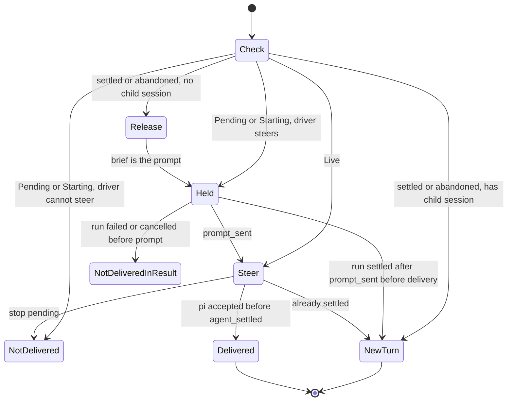
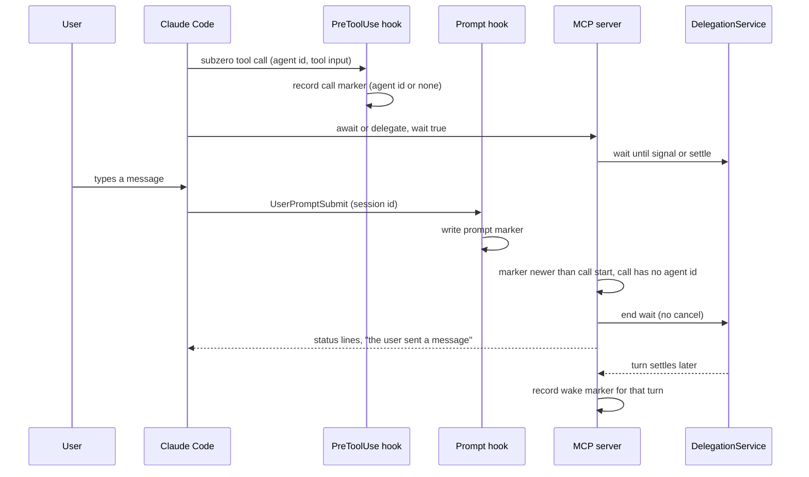

# Continue With Steering and Parallel Limits Per Model - Plan

## Goal Capsule

- **Objective:** While a subagent works, a person can tell the parent agent something new, and the parent can pass it to that subagent at once or continue the subagent after it finishes, on both Claude Code and pi, without losing the subagent's work; and a person can cap how many children run at once on each model.
- **Means:** Implement decisions 35–60 in `docs/decisions.md` to the revised Sigil contracts in `design/*.sigil`: turns and follow-up messages in the core, pi `steer` and session relaunch in the driver, one `continue` tool per parent, waits that end when the user types, and `models.parallel` in the agent file (KTD1–KTD19).
- **Authority:** `docs/decisions.md` decisions 35–60, then `design/*.sigil`, then this plan, then the code. Where this plan's KTDs add a rule the contracts lack, U1 writes it into the contracts first.
- **Execution profile:** Code change across every layer: config, core, store, pi driver, delegation service, both parent adapters, Claude hooks, docs. Test-first for TaskStore and TaskCore (U6, U7), because every later unit depends on the turn model. The scripted fake pi grows `steer` and session relaunch (U8).
- **Stop conditions:** Stop and ask if a settled decision proves infeasible in code, if the Claude Code probe in U1 shows that neither the agent id nor a tool-use id reaches subzero (R15 then has no safe trigger), or if a contract rule conflicts with another and no decision chooses.
- **Open blockers:** None. One probe (U1) gates only the Claude Code early end.
- **Who finishes:** `ce-work` implements the units. A person runs the live acceptance checks in the Verification Contract on both parents.

---

## Product Contract

### Summary

v0.2 adds `continue` to both parents, so a parent can steer a running subagent with new information, hold a message for one that has not started, or start a new turn on one that finished, and every turn returns one result. Waits end early when the user types, so the parent reads the message before the child finishes. Parallel limits move from model endpoints to whole models, and the old `endpoints:` key becomes a load error that guided init repairs.

### Problem Frame

A subagent that goes the wrong way today can only be cancelled and delegated again, which throws away up to twenty minutes of child work. The spike's long children (2–3 hours on one local GPU) make that loss real. Worse, on Claude Code calls wait by default, so a message the user types reaches the parent only after the child has settled, too late to change anything. The parallel limit is per endpoint, which fits one server per provider but not cloud providers that limit each model, or servers that run each model in its own process.

### Requirements

**Continue and steering**

- R1. Each parent offers one tool, `continue` on Claude Code and `subzero_continue` on pi, that takes a task id and a follow-up message, and the task's state decides what happens: held while Pending or Starting, steered while running, a new turn when settled or abandoned. The reply names the delivery outcome (decisions 36, 50).
- R2. A follow-up message for a task whose child has not sent its prompt is held and delivered, in order, right after the prompt (decision 39). A task that never sent its prompt is released with its original brief, and the message follows (decision 40).
- R3. A steering message joins the running turn through pi `steer`, never `follow_up`, so the turn still settles once with one result (decision 37).
- R4. Only tasks of the current parent session id can be continued. Another process takes a task over unless the task's latest turn is running in a live owner, and this holds on both parents (decisions 41, 51).
- R5. A continued turn runs on the task's frozen agent definition, model and thinking level, with no override (decision 42).
- R6. Each new turn gets the agent's full timeout, each delivered steering message restarts the running turn's timeout, and nothing caps a task's total time (decision 43).
- R7. Every turn returns exactly one result, task id first, naming its turn from turn 2 on, with no count of steering messages (decision 44).
- R8. When a later turn opens before an earlier turn's result was collected, collecting the task returns every uncollected turn oldest first, then the latest turn's status line; a result whose held messages opened a new turn says so in one line, and a notice never lists its own task as running (decision 58).
- R9. A held message whose turn sent its prompt and settled first opens a new turn; held messages of a child run that failed or was cancelled before its prompt are not delivered, and that turn's result says so (decision 49).
- R10. Messages of an abandoned turn that never sent its prompt are replayed, in order, before the new message of the next turn, and the reply says so; after a pi reload or resume, the parent's next turn gets one notice listing the stopped tasks and the messages that did not reach them (decision 60).
- R11. Steering and new turns are optional offerings of a child driver; a parent asking a child host without them gets a refusal (decision 47).
- R12. Every message a child receives, the brief included, is written whole to the event log, and the task record keeps the brief and each turn with its message and result (decision 45).

**Waits that end when the user types**

- R13. On pi, a message the user types during a waited `subagent`, `subzero_continue` or `subzero_await` call ends the wait without cancelling anything; the children keep running and report by completion notice (decision 38).
- R14. On Claude Code, a message the user types during a waited `delegate`, `continue` or `await` call made by the main conversation ends that wait the same way, and each task left running reports by wake marker (decision 57).
- R15. A waited call made inside a Claude Code subagent, or one whose caller cannot be identified, never ends early (decision 59).
- R16. The Claude Code `continue` tool always replies at once with the delivery outcome, never with an MCP task; its `wait` defaults to true; a new turn it does not wait for, or one opened by held messages, reports through a wake marker for that turn (decisions 54, 55).

**Parallel limits per model**

- R17. `models.parallel` maps a whole model id to the most child runs one process runs at once on it, shared by every tier that names that model; a model with no entry has no limit (decision 48).
- R18. An agent-file entry that no tier uses is a load error, and a global entry that no tier of the project uses is ignored (decision 52).
- R19. A file holding `endpoints:` fails to load with an error that names the file, says it was replaced by `models.parallel`, and lists the models each old limit covered: the merged configuration's for the agent file, the global file's own tiers' for the global file (decisions 48, 53).
- R20. Guided init repairs `endpoints:`: it pre-fills each listed model's limit with the old value, shows the change in its diff, writes only after confirmation, and repairs the file that the chosen scope does not write first, in its own confirmed step (decisions 48, 56). `init <model>` does not repair.

**Compatibility**

- R21. Task records written by v0.1, with a single result file and no turn data, read as one-turn tasks with no migration step.

### Key Decisions

- **One `continue` tool chosen by task state.** (session-settled: user-directed — chosen over separate `steer` and `continue` tools: one tool removes the race with a child that settles just before the message arrives.) Governs R1.
- **Steering stays in its turn.** (session-settled: user-directed — chosen over pi `follow_up` and a second result: a steered turn still settles once.) Governs R3, R7.
- **Current parent session only, with takeover.** (session-settled: user-directed — chosen over continuing any task of the project: smaller scope, and reload and resume still work.) Governs R4.
- **Takeover blocked only by a running turn in a live owner, on both parents.** (session-settled: user-directed — chosen over refusing any live owner and over a pi-only rule: only the owner of a running turn holds the child's stdin.) Governs R4.
- **Steering restarts the timeout, with no ceiling.** (session-settled: user-directed — chosen over a fixed timeout and over a ceiling of twice the timeout.) Governs R6.
- **No steering count in the result; turn number from turn 2.** (session-settled: user-directed — chosen over a "steered: N" line.) Governs R7.
- **Every uncollected turn reaches the parent.** (session-settled: user-directed — chosen over returning only the latest turn: the answer to the brief must not be hidden by a turn its own queued message opened.) Governs R8.
- **Held messages, never-started tasks and abandoned turns lose nothing.** (session-settled: user-directed — chosen over refusing a never-started task and over reporting undelivered messages without replaying them.) Governs R2, R9, R10.
- **Waits end early on both parents, main conversation only on Claude Code.** (session-settled: user-directed — chosen over a documented limit on Claude Code and over ending subagent waits too: a subagent cannot see the user's message.) Governs R13, R14, R15.
- **`continue` never answers with an MCP task.** (session-settled: user-directed — chosen over joining task mode: "steered" needs no follow-up and the parent should know it at once.) Governs R16.
- **Limits per model, `endpoints:` a load error that guided init repairs.** (session-settled: user-directed — chosen over keeping both limits and over silent conversion: a one-GPU limit shared by several models must not silently become one limit for each.) Governs R17–R20.

### Success Criteria

- On each parent, a person delegates a long task, types new information mid-run, and the child's final answer reflects it in the same turn, with no restart.
- On each parent, a person continues a finished task and the child answers from its earlier context.
- A one-GPU setup with `models.parallel` set to 1 for its model runs its children one at a time across every tier that names that model.

### Scope Boundaries

- Continuing tasks of another parent session id is out; R4 limits it.
- Model or thinking overrides on `continue` are out (R5).
- A `/subzero continue` command or `subzero continue` CLI command is out; the parent decides.

#### Deferred to Follow-Up Work

- The rest of the former v0.2 moved to v0.3 in `docs/decisions.md` "Suggested phasing": `ask`, `fork`, `rerun`, reports, `process: keep`, other child hosts.
- The prompt marker misses a message submitted before a waited call started, and the server can follow the old session id for up to 5 seconds after `/clear`; both are documented as limits, not fixed.

### Sources / Research

- `docs/decisions.md` decisions 35–60 and the pi 1.5.2 checks after decision 57; `docs/spike-results.md` "Parent adapter platform probe" for the Claude Code prompt-hook probe.
- pi 1.5.2 RPC docs (`steer`, `get_session_stats` "across the full session"); pi writes the session file as soon as the first user message exists (`dist/core/session-manager.js`, `_hasConversation`), so `prompt_sent` is a sound "has a child session" signal.

---

## Planning Contract

### Key Technical Decisions

- KTD1. **One run object per turn.** A task holds an ordered list of turns, and each turn owns its child run, result promise, state listeners and enqueue and start times. Listeners attached to a turn never fire for a later turn, which removes the duplicate completion notices and the queue listener leak that the per-task `Task.onStateChange` causes today (`src/core/task-core.ts`, `src/service/delegation-service.ts` `EndpointLimiter`).
- KTD2. **Steering and resume travel on the child port.** `ChildPort` gains an optional `resume` start and a static `steers` flag; `ChildRun` gains an optional `steer` that answers delivered, settled or stopping. TaskCore must decide queued against not delivered before any run exists, so the capability is static. Kernel mirrors both like `attachCommand`, so no core service receives a driver (R11).
- KTD3. **"Delivered" means pi accepted the steer before `agent_settled` with no stop pending.** RPC responses and events arrive in order on one stdout, so a `steer` response dispatched while `settledSeen` is false counts, whether its disposition is `queued` or `handled`. A steer while a stop is pending answers stopping, and TaskCore returns not delivered (R3). pi makes its last queue check before it emits `agent_settled`, so a steer accepted in that window can settle unread: the driver tracks `queue_update` events, and steering messages still queued at `agent_settled` are reported as unread, and TaskCore opens a new turn with them, as for a held message (R9).
- KTD4. **Usage is per turn.** Before a resume prompt the driver reads `get_session_stats` and reports the difference at settle, because pi reports tokens and cost across the whole session; context use at settle is reported as read.
- KTD5. **Turn files are claimed exclusively, with their owner.** Turn n lives in `turns/<n>.json`; a v0.1 file that is a bare `Result` reads as turn 1 (R21). A new turn is claimed by creating its file with exclusive create, holding the claiming owner process (pid and start time), and the latest turn is the highest n. This serializes turn opening across processes without a lock, which decision 11 forbids, and makes claim and ownership one step.
- KTD6. **Continuations of one task run one at a time in a process.** A per-task queue in DelegationService orders continuations; a process that loses the exclusive create re-reads the task and holds, steers or answers not delivered.
- KTD7. **Ownership and tier are durable.** A running turn's owner is the one in its turn file (KTD5); the sweep and the takeover check read it from there. The takeover line in the task index is appended only after the claim succeeds, and a process that loses the claim writes no index line. The index keeps the latest owner line and the first line's creation time (today `readLatest` keeps the first owner, so a takeover is invisible). `task.json` stores the tier, so a task loaded from its record shows its tier.
- KTD8. **"Has a child session" comes from the `prompt_sent` event.** The driver sets `sessionFile` before the prompt, so it proves nothing. A v0.1 record with no `prompt_sent` event falls back to the session file existing. Before a resume the driver checks the session file exists; when it is gone, the task is released with its brief and the message is held.
- KTD9. **Waiting and cancelling are separate.** DelegationService wait handles take an "until" signal that ends the wait and returns current state, distinct from the abort that cancels. Both parents' early end (R13, R14) uses it.
- KTD10. **The queue's unit is a turn, keyed by model, limit read at admission.** Only a continuation that opens a new turn, a new turn or a release, reloads the merged configuration, just before its run enters the model queue, and the limit comes from it by model. A task loaded from its record and one held in the registry then behave the same. Steering and holding use the frozen task record and never load the configuration, so a broken agent file cannot block steering a running child. A load error at a new turn's admission answers not delivered with that error, and no turn is claimed.
- KTD11. **An in-flight continuation is registered before its first await.** The live registry marks the task as opening, so a session cancel that arrives during the sweep or the config load stops the turn before it starts, and the reply is not delivered (cancelled).
- KTD12. **Notices for turns no call opened go through a sink.** Each front end registers one notice sink with DelegationService; a turn opened by held messages (R9) or replay (R10) reports there. ClaudeMcpServer writes a wake marker for the turn (R16); PiExtension sends the completion notice.
- KTD13. **Collecting is per turn and durable.** A turn counts as collected once `tasks/<id>/turns/<n>.collected` exists. Every path that delivers a turn's result to the parent writes it: a collect, a waited reply, the wake hook claiming the turn's marker, and an MCP task result. Await and the notice's collect hint return every settled turn not yet collected, oldest first, then the latest turn's status line (R8). A reloaded, restarted or taking-over process therefore neither repeats nor skips a turn. Wake markers are keyed by task and turn, and a collect clears only the markers of the turns it returned.
- KTD14. **The `endpoints:` error is raised after the merge.** `parseLayer` throws before tiers merge, so the error that lists covered models moves to `build()`. Guided setup reads a lenient catalog, and a repair-step preview may keep load errors that come only from the chosen file's `endpoints:` map, a missing medium tier or an unused limit, which the next step repairs. Without this the first step of decision 56 is always refused.
- KTD15. **Claude Code knows a subagent call through its hook input.** The PreToolUse hook also matches subzero's tools and records each call's agent id, keyed by the tool-use id when Claude Code passes it to the MCP server in request metadata, otherwise by a hash of the tool input, which equals the MCP arguments. The server ends a wait early only for a call whose marker is found and records no agent id; a call with an agent id, or with no marker found, never ends early (R15). U1's probe decides which key is available.
- KTD16. **The prompt hook prints nothing.** A UserPromptSubmit hook's stdout on exit 0 becomes Claude's context, so the prompt hook writes the prompt marker under `plugin data folder/sessions/<project key>/` and exits 0 silently, as the wake and session hooks do.
- KTD17. **Each follow-up message event records its delivery outcome.** The event log then never shows an undelivered message as received, and a release turn's file marks the brief as its prompt.
- KTD18. **Forced waits cover turns opened by held messages.** In pi print mode and non-interactive Claude Code, the call waiting on a turn also waits for any turn its held messages open and returns both results, because nothing would collect them after exit.
- KTD19. **A task with no parent session id gets a distinct reply.** `delegate` without a session id adds one line saying the task cannot be continued; `continue` from an unidentified conversation, or on a task without an id, answers "this conversation could not be identified" instead of the other-session wording.

### High-Level Technical Design

Where a follow-up message goes, by the latest turn's state (TaskCore, KTD1–KTD3, KTD8):

Claude Code early end, main conversation only (KTD9, KTD15, KTD16):

Task record layout after v0.2 (KTD5, KTD7, KTD17):

| Path | Holds |
|---|---|
| `tasks/<id>/task.json` | frozen agent definition, brief, tier, launch spec of the latest run |
| `tasks/<id>/turns/<n>.json` | turn n: claiming owner, opening message and replayed messages from turn 2 on, enqueue and start times, stop reason, result once settled; turn 1 of v0.1 is a bare result |
| `tasks/<id>/turns/<n>.collected` | empty; present once turn n's result reached the parent |
| `tasks/<id>/events.jsonl` | every domain event, brief and follow-up messages whole, each with its delivery outcome |
| `index.jsonl` | status lines; owner on the first line and on each takeover line |

### Risks & Dependencies

- U1's probe may show Claude Code passes neither agent id to PreToolUse for MCP tools nor a tool-use id to the server. Then R15 has no safe trigger and R14 cannot ship without breaking subagents; stop and ask (Goal Capsule).
- Moving every reader to turn-aware status touches listings in both parents and the CLI; a reader left on `turns/1.json` would show a running turn 2 as settled. U6's tests pin every reader.
- `test/helpers.ts` `DEFAULT_YAML` uses `endpoints:`, which becomes a load error, and several tests rely on two models sharing one endpoint limit; U2 moves them to one shared model.

---

## Implementation Units

| U-ID | Title | Key files | Depends on |
|---|---|---|---|
| U1 | Contracts and decisions | `docs/decisions.md`, `design/*.sigil` | none |
| U2 | Per-model limits in AgentConfig | `src/config/agent-config.ts`, `test/helpers.ts`, examples | U1 |
| U3 | Queue per model and wording | `src/service/delegation-service.ts`, `src/service/status-text.ts`, `src/core/task-core.ts` | U2 |
| U4 | Guided setup repairs `endpoints:` | `src/config/agent-setup.ts`, `src/cli/cli.ts`, `skills/init/guided-init.md` | U2 |
| U5 | Child port, Kernel and core types | `src/core/types.ts`, `src/kernel/kernel.ts` | U1 |
| U6 | TaskStore turns | `src/store/task-store.ts` | U5 |
| U7 | TaskCore turns and follow-up messages | `src/core/task-core.ts` | U5, U6 |
| U8 | PiDriver steer, resume and usage | `src/pi/driver.ts`, `test/fake-pi/fake-pi.mjs` | U5 |
| U9 | DelegationService continuation | `src/service/delegation-service.ts` | U3, U7, U8 |
| U10 | Claude MCP `continue`, early end, wake markers | `src/mcp/server.ts`, `src/mcp/wake-markers.ts` | U9, U11 |
| U11 | Claude prompt hook and call markers | `src/mcp/prompt-hook.ts`, `src/routing/agent-hook.ts`, `hooks/hooks.json` | U1 |
| U12 | pi `subzero_continue` and early end | `src/pi-parent/extension.ts` | U9 |
| U13 | Docs, examples and contract alignment | `docs/configuration.md`, `README.md`, `docs/status.md` | U2–U12 |

### U1. Contracts and decisions

**Goal:** Record decisions 58–60 and the rules KTD3–KTD19 add, so the contracts stay the authority before code follows them.

**Requirements:** R8, R10, R15, R21.

**Dependencies:** none.

**Files:** `docs/decisions.md`, `docs/status.md`, `docs/spike-results.md`, `design/task-core.sigil`, `design/task-store.sigil`, `design/delegation-service.sigil`, `design/pi-driver.sigil`, `design/claude-mcp-server.sigil`, `design/claude-routing-hooks.sigil`, `design/pi-extension.sigil`, `design/agent-config.sigil`.

**Approach:**
1. Probe first: in an interactive Claude Code session, log the PreToolUse input for an MCP tool call from the main thread and from a subagent, and log the MCP request metadata the server receives. Record which of agent id and tool-use id are present in `docs/spike-results.md`; if neither, stop per the Goal Capsule.
2. Add decisions 58 (every uncollected turn), 59 (main-conversation early end on Claude Code), 60 (replay and reload report) to the v0.2 section, each with its reason.
3. Write the KTD rules that change contract meaning into the owning contract: per-turn durable collect and sink (DelegationService), exclusive turn claim with its owner, latest owner, tier and v0.1 records (TaskStore), delivered, stopping and unread steers, usage delta, session-file check (PiDriver), delivery outcome on events and the session-end stop reason (TaskCore), call markers keyed by the probe's result (ClaudeRoutingHooks, ClaudeMcpServer), reload report (PiExtension), repair-step tolerance (AgentConfig).
4. Run `sigil check` and `sigil fmt` on the changed files.

**Patterns to follow:** the decision entries 35–57 and the earlier contract revisions on this branch.

**Test expectation:** none -- design documents and a recorded probe; `sigil check` is the gate.

**Verification:** the probe result is recorded, `sigil check .` reports 0 diagnostics, and each KTD that changes behavior is stated in one contract.

### U2. Per-model limits in AgentConfig

**Goal:** Load `models.parallel` by model, and refuse `endpoints:` with the error R19 describes.

**Requirements:** R17, R18, R19.

**Dependencies:** U1.

**Files:** `src/config/agent-config.ts`, `test/config/agent-config.test.ts`, `test/helpers.ts`, `test/service/delegation-service.test.ts`, `test/mcp/server.test.ts`, `test/pi-parent/extension.test.ts`, `examples/demo/.agents/subzero.yaml`, `examples/sigil/.agents/subzero.yaml`, `test/wiring/wiring.test.ts`.

**Approach:**
1. Parse `models.parallel` in both layers, merge by model id, and allow removal entries in the agent file.
2. Replace `endpoint` and its limit on `AgentDefinition` with the model's limit (KTD10 reads it again at admission).
3. Raise the `endpoints:` load error in `build()` after the merge (KTD14), listing models per R19; add `models.parallel` to the global file's allowed keys.
4. Move `DEFAULT_YAML` and the two examples to `models.parallel`, and put the tests that relied on a shared endpoint limit onto one shared model.

**Patterns to follow:** the layer parse and merge of `models.tiers` and the existing unused-limit check in `build()`.

**Test scenarios:**
- Covers R17. Two tiers naming `local/qwen` with `models.parallel: { local/qwen: 1 }` both resolve with limit 1; a model with no entry resolves with none.
- Covers R18. An agent-file limit for a model no tier uses fails naming the model; the same entry in the global file is ignored.
- Covers R19. An agent file with `endpoints: { local: { parallel: 1 } }` and tiers on `local/a` and `local/b` fails naming the agent file and listing both models; a global file's error lists only the global file's own tiers' models.
- A removal entry for a global model's limit in the agent file removes it from the merged configuration.
- A limit that is zero or not a whole number fails naming the model.
- The demo and sigil examples load, and `sigil-interpreter` and `sigil-interpreter-low` share the limit of `r9700/Qwen3.8`.

**Verification:** the config tests and the wiring test pass with no `endpoints:` left in fixtures.

### U3. Queue per model and wording

**Goal:** Queue a child run by its model with the current limit, and word every status line by model.

**Requirements:** R17, KTD10.

**Dependencies:** U2. U2 and U3 land as one change: U2 removes `endpoint` from the agent definition, and its readers are fixed here, so the Types gate applies to the pair.

**Files:** `src/service/delegation-service.ts`, `src/service/status-text.ts`, `src/core/task-core.ts`, `src/cli/cli.ts`, `src/routing/routing.ts`, `test/service/delegation-service.test.ts`, `test/service/status-text.test.ts`.

**Approach:**
1. Key the limiter by model and read the limit from the merged configuration at each admission.
2. Replace every reader of the agent definition's `endpoint` with its model, the task record's first write in TaskCore included.
3. Change "endpoint" to "model" in the status line, the CLI waiting text and the SessionStart routing text.

**Patterns to follow:** the current limiter's first-come-first-served release and queue-place counting.

**Test scenarios:**
- Two delegations through `small` and `medium`, both on `local/qwen` with limit 1, start one child and queue the other at place 1.
- A limit raised in the agent file between two delegations applies to the second admission.
- A queued run cancelled while Pending frees its place and later runs move up.
- The queued status line reads "starts when model `local/qwen` has room".

**Verification:** queue tests pass and no "endpoint" wording remains in status text.

### U4. Guided setup repairs `endpoints:`

**Goal:** Let guided init set limits per model and repair `endpoints:` in either file, the other scope's file first.

**Requirements:** R20, KTD14.

**Dependencies:** U2.

**Files:** `src/config/agent-setup.ts`, `src/service/setup-service.ts`, `src/cli/cli.ts`, `src/pi-parent/init.ts`, `skills/init/guided-init.md`, `test/config/agent-setup.test.ts`, `test/service/setup-service.test.ts`, `test/cli/config.test.ts`, `test/release/init-skill.test.ts`.

**Approach:**
1. Change set entries `setLimit`/`clearLimit` take a model; the CLI flags become `--limit <model>=<n>` and `--no-limit <model>`; the pi init tool schema follows.
2. The setup state lists each `endpoints:` entry with its limit, its file and its covered models, and marks a file repairable when `endpoints:` is its only problem; an `endpoints:` key in the other file adds a "repair the other file first" state instead of refusing.
3. A repair-step preview tolerates the load errors KTD14 names; its apply removes the `endpoints:` map with its comment lines.
4. The guide text asks the limit of every listed model, pre-filled, repairs the other file first in its own confirm, and ends with nothing written when the user declines.

**Patterns to follow:** the existing `repairable` setup state and the lenient catalog in `src/config/agent-setup.ts`.

**Test scenarios:**
- Covers R20. An agent file with `endpoints: { r9700: { parallel: 1 } }` previews limits for both covered models pre-filled with 1; apply writes them and removes `endpoints:`, and the file loads.
- A global file with `endpoints:` and scope "only this project" offers the global repair first; after its apply, the project preview applies.
- Both files hold `endpoints:`: the first repair step's apply succeeds although the chosen file still holds `endpoints:`.
- Declining the repair step writes nothing and ends the init.
- `config preview --limit local/qwen-coder:30b=2` parses a model id containing a colon.
- `init <model>` on a file with `endpoints:` refuses with the load error and does not repair.

**Verification:** setup, CLI and init-skill tests pass, and the guide text names models, not endpoints.

### U5. Child port, Kernel and core types

**Goal:** Give the core the types for turns, follow-up messages and the optional steering and resume offerings.

**Requirements:** R7, R11, R12, KTD2.

**Dependencies:** U1.

**Files:** `src/core/types.ts`, `src/kernel/kernel.ts`, `test/kernel/kernel.test.ts`, `test/helpers.ts`.

**Approach:**
1. Add `turn` to `Result` from turn 2 and a "held messages not delivered" line.
2. Add domain events `brief`, `prompt_sent` and `follow_up_message` (with delivery outcome, KTD17).
3. Add `ChildPort.resume`, `ChildPort.steers` and `ChildRun.steer` (KTD2), and the `DeliveryOutcome` type.
4. Mirror `steers` and `resume` in Kernel and extend `manualPort` in `test/helpers.ts` with scriptable steer and resume.

**Patterns to follow:** optional `attachCommand` and `sessionExport` in `ChildDriver` and their Kernel getters.

**Test scenarios:**
- Kernel returns `undefined` for steering and resume when the registered driver offers neither.
- Kernel returns the pi driver's offerings when it is registered.

**Verification:** types compile and kernel tests pass.

### U6. TaskStore turns

**Goal:** Store each turn, resolve the latest turn in every reader, and keep the latest owner.

**Requirements:** R7, R12, R21, KTD5, KTD7.

**Dependencies:** U5.

**Files:** `src/store/task-store.ts`, `test/store/task-store.test.ts`.

**Approach:**
1. Write `turns/<n>.json` per turn, created exclusively with the claiming owner when a turn opens (KTD5); read a bare v0.1 `Result` as turn 1.
2. Store the brief and tier in `task.json`; keep enqueue and start times and the stop reason per turn.
3. Make status, listing and the start-up sweep read the latest turn and take a running turn's owner from its turn file; a turn file with no result means running.
4. Keep the latest owner line and the first line's creation time; append a takeover line only after the claim succeeds (KTD7).
5. Write and read the per-turn collected marker (KTD13).

**Execution note:** Write the reader tests first, including a v0.1 record fixture, before changing the write path.

**Patterns to follow:** the current write-result-then-index-line order and the corrupt-trailing-line handling.

**Test scenarios:**
- Covers R21. A v0.1 record with `turns/1.json` as a bare result lists as completed turn 1.
- A task settled at turn 1 with turn 2 opened reads as running, and its listing shows turn 2's enqueue time, not turn 1's start time.
- A second exclusive create of `turns/2.json` fails, the store reports the turn as taken, and the losing claimant writes no index line, so the winner stays the running turn's owner.
- A takeover claim by a new owner makes the sweep of the new owner leave the running turn alone; the dead old owner no longer marks it abandoned.
- A turn with a collected marker is not counted as uncollected by a fresh store reader.
- The sweep marks a task abandoned when the owner of its running turn 2 is dead, although turn 1 holds a result.
- A task loaded from its record shows its tier.

**Verification:** store tests pass, including the v0.1 fixture.

### U7. TaskCore turns and follow-up messages

**Goal:** Route each follow-up message by the latest turn's state, as the state diagram shows.

**Requirements:** R1, R2, R3, R5, R6, R7, R9, R10, R11, R12, KTD1, KTD8, KTD17.

**Dependencies:** U5, U6.

**Files:** `src/core/task-core.ts`, `test/core/task-core.test.ts`.

**Approach:**
1. Split the task into turns, each with its run, result and listeners (KTD1); Live begins at `prompt_sent`, not `skills_verified`.
2. Hold messages while Pending or Starting when the port steers; flush them in order at `prompt_sent`; answer not delivered when it does not.
3. Steer while Live; on "settled" open a new turn; on "stopping" answer not delivered (KTD3).
4. Open a new turn on a settled or abandoned turn: resume when the task has a child session (KTD8), else release with the brief and hold the message; replay an abandoned unprompted turn's messages first (R10).
5. Load a task from its record, the same-owner case after a pi reload included.
6. Write each message event with its delivery outcome, and the brief event at turn 1.

**Execution note:** Implement test-first against the scripted port; every branch of the state diagram gets a failing test before code.

**Patterns to follow:** the existing `scriptedPort` in `test/core/task-core.test.ts` and the `finish()` single-settle rule, now per turn.

**Test scenarios:**
- Covers R2. A message to a Pending task answers queued and reaches `steer` right after `prompt_sent`.
- Covers R3. A message to a Live run answers steered, and the turn settles with one result.
- Covers R9. A held message whose run settles after `prompt_sent` but before delivery opens turn 2 with it as the prompt.
- Covers R9. A held message whose run fails `skill_mismatch` before its prompt is not delivered, the turn's result says so, and no turn opens.
- Covers R2. A message to a task cancelled while Pending releases it with the brief, then steers the message.
- Covers R10. Turn 2 abandoned before its prompt with two messages; a third message opens turn 3 whose run gets the two old messages first, in order, then the third.
- A steer that answers "stopping" returns not delivered and opens no turn.
- A port without steering answers not delivered for a Pending task and for a never-started release.
- Turn 2's listeners fire once when turn 2 settles; turn 1's do not fire again.
- A task loaded from its record continues with turn 2 and never re-sends the brief.
- Covers R5. After the agent file changes a tier's model, a continuation of an earlier task starts its new turn with the task's frozen agent definition, model and thinking level, and the continue call accepts no override.
- Steering messages the driver reports unread at settle open turn 2 with them, in order.
- A run stopped by a session cancel records the session-end stop reason on its turn.
- The event log holds the brief event and each follow-up message with its outcome.

**Verification:** every branch of the state diagram has a passing test.

### U8. PiDriver steer, resume and usage

**Goal:** Offer turn steering and session resume on the pi driver, with the timeout restart and per-turn usage.

**Requirements:** R3, R6, R7, R11, KTD2, KTD3, KTD4, KTD8.

**Dependencies:** U5.

**Files:** `src/pi/driver.ts`, `test/pi/driver.test.ts`, `test/fake-pi/fake-pi.mjs`.

**Approach:**
1. `PiChildRun.steer` sends pi `steer`, answers delivered when the response dispatches before `agent_settled` and no stop is pending, settled after settle, stopping otherwise; a delivered steer re-arms the timeout timer. Track `queue_update` events, and report steering messages still queued at `agent_settled` as unread in the outcome (KTD3).
2. `resume` starts pi with the same flags and sends the follow-up message as the prompt, after checking the session file exists and reading `get_session_stats` for the usage baseline.
3. Report `prompt_sent` once the prompt command returns.
4. Extend the fake pi: a `steer` command, an `awaitSteer` step that echoes the steer before `agent_settled`, a session file that keeps prompts and steers across launches, per-launch scripts, and cumulative stats.
5. Update driver comments from pi 0.87 to 1.5.2.

**Patterns to follow:** the RPC id correlation in `src/pi/rpc-client.ts` and the stop and settle bookkeeping in `PiChildRun`.

**Test scenarios:**
- A steer during an `awaitSteer` step answers delivered, the final text echoes it, and the run settles once.
- A steer after `agent_settled` answers settled and sends nothing.
- A steer the fake accepts after its final queue check, then settles without reading, is reported unread in the outcome.
- A steer while a cancel is in progress answers stopping.
- A steer at 9 seconds into a 10-second timeout restarts the timer, and the run does not time out at 10 seconds.
- A resume on a session with one earlier prompt starts pi with the same `--session-id` and `--session-dir` and no `--session`, and the fake recalls turn 1.
- A resume whose session file is missing fails so TaskCore releases with the brief.
- Turn 2's usage equals cumulative stats minus the baseline read before its prompt.
- `prompt_sent` is reported after `get_commands` passes and never for a skill-mismatch run.

**Verification:** driver tests pass against the extended fake pi.

### U9. DelegationService continuation

**Goal:** Turn a front end's continuation into TaskCore calls under the session, takeover, queue and collect rules.

**Requirements:** R1, R4, R8, R10, R16, KTD6, KTD9, KTD10, KTD11, KTD12, KTD13, KTD18, KTD19.

**Dependencies:** U3, U7, U8.

**Files:** `src/service/delegation-service.ts`, `src/service/status-text.ts`, `test/service/delegation-service.test.ts`, `test/service/status-text.test.ts`.

**Approach:**
1. Add `continue`: register the task as opening (KTD11), sweep, check scope and owner (R4), load the task from its record when needed, and hand the message to TaskCore under a per-task queue (KTD6). Only a path that opens a new turn reloads the configuration, before admission (KTD10); the takeover line follows a won claim (KTD7).
2. Add the "until" signal to delegate and wait handles (KTD9).
3. Make the admitted queue unit a turn's run and remove its Cancelled listener when the run settles (KTD1).
4. Add the notice sink and durable per-turn collection (KTD12, KTD13); notices and collects become per turn; a notice excludes its own task from the running list.
5. Word the delivery outcomes, the turn line, the "queued message opened turn N" line and the unidentified-session reply (KTD19).
6. In forced-wait modes, a waited call also waits for turns its held messages open (KTD18).
7. Persist the tier through the task record (KTD7).

**Patterns to follow:** `collect`, `waitFor`, `cancelSession` and the status-text owners of all wording.

**Test scenarios:**
- Covers R4. A continuation from another parent session id answers not delivered with the first result line and no result.
- Covers R4. A settled task whose owner process is alive in another process is taken over; a running turn in a live other owner answers not delivered.
- Covers R8. Turn 1 settles, its held message opens turn 2, and a collect returns turn 1's result, the "opened turn 2" line and turn 2's status line, in that order.
- A second collect after both turns settle returns only turn 2.
- A fresh service that loads a task with turn 1 collected and turn 2 settled returns only turn 2.
- With an agent file that has a load error, a running task is still steered, and a continuation that would open a new turn answers not delivered with the load error and claims no turn.
- After 20 settled turns on one task, the limiter holds no listeners for that task.
- Two continuations in one tick on a settled task open exactly one turn; the second steers or holds into it.
- A session cancel during a continuation's config load prevents the turn from starting and answers not delivered (cancelled).
- A waited delegate ended by the "until" signal returns its status line and the child keeps running.
- A turn opened by held messages reports through the sink once.
- A continuation with no parent session id answers "this conversation could not be identified".
- A continuation on an abandoned task opens a new turn, and the record names this process as owner.

**Verification:** service tests pass, and no test relies on `turns/1.json`.

### U10. Claude MCP `continue`, early end and wake markers

**Goal:** Expose `continue` on Claude Code, end main-conversation waits when the user types, and key wake markers by turn.

**Requirements:** R1, R8, R14, R15, R16, KTD9, KTD12, KTD13.

**Dependencies:** U9, U11.

**Files:** `src/mcp/server.ts`, `src/mcp/wake-markers.ts`, `src/mcp/format.ts`, `test/mcp/server.test.ts`, `test/mcp/wake-markers.test.ts`.

**Approach:**
1. Register `continue` without `alwaysLoad`; it never answers with an MCP task, `wait` defaults to true, and the 120-second cancel rule and progress apply when it waits.
2. While a waited call blocks, watch the prompt marker; when it is newer than the call start and the call's marker is found and records no agent id (KTD15), end the wait with KTD9 and start a wake marker for each task left running that has none.
3. An await ended early returns settled turns as a normal await does, then status lines.
4. Key wake markers by task and turn; collects clear only the turns returned; the notice sink writes a marker for turns no call opened.
5. Add the server-instruction line telling the parent when to use `continue`.

**Patterns to follow:** the existing delegate and await wait paths and the wake-marker start, finish and clear calls.

**Test scenarios:**
- Covers R16. `continue` on a running task replies steered at once in task mode.
- Covers R16. `continue` with `wait: false` on a settled task replies new turn, and the turn's wake marker later holds its result naming turn 2.
- Covers R14. A waited `await` over two running tasks returns their status lines when a prompt marker newer than the call appears, and both tasks keep running.
- Covers R15. The same await from a call whose marker carries an agent id keeps waiting.
- An await ended early over one settled and one running task returns the settled result whole, then the status line.
- Collecting turn 1 clears turn 1's marker and leaves turn 2's.
- A turn whose result the wake hook already delivered is not returned again by `await`.
- A waited call with no call marker found keeps waiting when the prompt marker changes.
- The tool list has five tools, and only `delegate` and `await` are always loaded.

**Verification:** server and wake-marker tests pass.

### U11. Claude prompt hook and call markers

**Goal:** Tell the server when the user types and which calls come from subagents.

**Requirements:** R14, R15, KTD15, KTD16.

**Dependencies:** U1.

**Files:** `src/mcp/prompt-hook.ts`, `src/mcp/parent-session.ts`, `src/mcp/wake-hook.ts`, `src/routing/agent-hook.ts`, `src/routing/routing.ts`, `hooks/hooks.json`, `build.mjs`, `bin/subzero`, `scripts/build-plugin.mjs`, `test/mcp/prompt-hook.test.ts`, `test/routing/agent-hook.test.ts`, `test/release/build-plugin.test.ts`, `test/release/shim.test.ts`.

**Approach:**
1. Add the prompt-hook bundle: it reads `session_id`, writes the prompt marker with the submit time, prints nothing and exits 0 on any error.
2. Extend the PreToolUse matcher to subzero's tools; for them, write a call marker keyed per KTD15, using the key U1's probe found, holding the agent id or none, and always allow. The wake hook writes the turn's collected marker when it claims a turn (KTD13).
3. Export the project key helper from `src/mcp/parent-session.ts` for both markers.
4. Register the bundle in `hooks/hooks.json`, `build.mjs`, `bin/subzero` and `scripts/build-plugin.mjs`.

**Patterns to follow:** `src/mcp/wake-hook.ts` and `src/mcp/session-hook.ts` for stdin parsing, `CLAUDE_PROJECT_DIR` and failing open.

**Test scenarios:**
- The prompt hook writes the marker for its session id with a time, and stdout stays empty.
- Malformed input exits 0 with no marker and no output.
- A PreToolUse input for `mcp__plugin_subzero_subzero__await` with an agent id writes a call marker naming it and allows the call.
- The same input without an agent id writes a marker with none.
- The plugin build contains the prompt-hook bundle, and the shim treats it as fail-open.

**Verification:** hook, release and shim tests pass.

### U12. pi `subzero_continue` and early end

**Goal:** Expose `subzero_continue` on pi, end waits on a mid-turn user message, and report what a reload stopped.

**Requirements:** R1, R8, R10, R13, KTD9, KTD12, KTD13, KTD18.

**Dependencies:** U9.

**Files:** `src/pi-parent/extension.ts`, `src/pi-parent/notices.ts`, `src/pi-parent/ui.ts`, `test/pi-parent/extension.test.ts`, `test/pi-parent/lifecycle.test.ts`.

**Approach:**
1. Register `subzero_continue` with an `async` flag; print mode forces a wait.
2. Handle the `input` event with `streamingBehavior: "steer"`: end any waited `subagent`, `subzero_continue` or `subzero_await` call through KTD9 and return `continue` so pi delivers the message.
3. A wait ended early sends the completion notice when its turn settles; the sink sends notices for turns no call opened.
4. At `session_start` with reason reload or resume, read the session's task records and send one notice listing turns stopped by a session end, and abandoned turns, not yet reported, with their undelivered messages (R10); then record each listed turn as reported through TaskCore, so a later reload does not repeat it.
5. Add the `subzero_continue` line to the subagent tool description; the widget shows the turn number.

**Patterns to follow:** the `subagent` and `subzero_await` registrations, `respond()`, and `sendCompletion`/`sendStopped` in `src/pi-parent/notices.ts`.

**Test scenarios:**
- Covers R13. A `subagent` call with `async: false` ends when an `input` event with `streamingBehavior: "steer"` arrives, returns the task id with its status line, and the child keeps running.
- Covers R13. The same for `subzero_continue` with `async: false` and for `subzero_await`.
- A wait ended early later yields exactly one completion notice for its turn.
- Covers R10. After a reload that cancelled a task with a held message, the next session sends one notice naming the task and the message.
- A second reload sends no notice for a task already reported, and a task the user cancelled earlier is never listed.
- `subzero_continue` on a background task replies steered; on a settled task it replies new turn, and the notice names turn 2.
- An `input` event with no streaming behavior ends nothing.

**Verification:** extension and lifecycle tests pass.

### U13. Docs, examples and contract alignment

**Goal:** Describe the built behavior and confirm the code matches the contracts.

**Requirements:** R1, R17, R19, R20.

**Dependencies:** U2–U12.

**Files:** `docs/configuration.md`, `README.md`, `docs/status.md`, `test/release/configuration-doc.test.ts`.

**Approach:**
1. Document `models.parallel`, the `endpoints:` error and its repair, `continue` on both parents, early end and its limits (a message submitted before a waited call started; the 5-second lag after `/clear`), and that a continued task whose model has no limit runs unlimited.
2. Mark v0.2 built in `docs/status.md`.
3. Run `sigil-align` on TaskCore, TaskStore, PiDriver, DelegationService, ClaudeMcpServer, ClaudeRoutingHooks, PiExtension and AgentConfig, and fix drift it finds.

**Patterns to follow:** the configuration-doc test that checks documented keys against the loader.

**Test scenarios:**
- The configuration-doc test finds `models.parallel` documented and `endpoints` documented only as removed.

**Verification:** docs tests pass and `sigil-align` reports no unresolved drift.

---

## Verification Contract

| Gate | Command | Applies to |
|---|---|---|
| Types | `npm run typecheck` | every unit; U2 and U3 together |
| Tests | `npm test` | every unit; U6 and U7 test-first |
| Build | `npm run build` | every unit |
| Plugin package | `npm run release:build` | U10, U11 |
| pi package | `npm run release:pi:build` | U12 |
| Contracts | `sigil check .` | U1, U13 |
| Contract alignment | `sigil-align` on the eight components in U13 | U13 |

Live acceptance, run by a person after U12 on each parent with a reachable model:
- Delegate a task of a few minutes, type new information mid-run, and see the parent steer it and the final answer reflect it.
- Continue a finished task and see the child answer from its earlier turn.
- On Claude Code, type during a waited `await` from the main conversation and see it return early; repeat from inside a subagent and see it keep waiting.
- With `models.parallel: { <model>: 1 }`, delegate through two tiers on that model and see one child at a time.

## Definition of Done

- Every requirement R1–R21 is covered by at least one passing test that names it, or by a live acceptance check above.
- Every branch of the TaskCore state diagram has a passing test.
- No fixture, example or doc uses `endpoints:` except to describe its removal.
- `docs/decisions.md` holds decisions 58–60, and the contracts state every KTD rule that changes behavior.
- The Claude Code probe result from U1 is recorded in `docs/spike-results.md`.
- All gates in the Verification Contract pass.
- No code from an approach that did not pan out remains in the diff.
